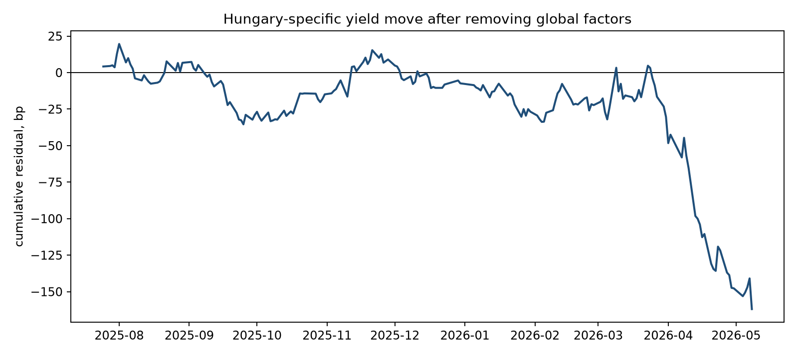
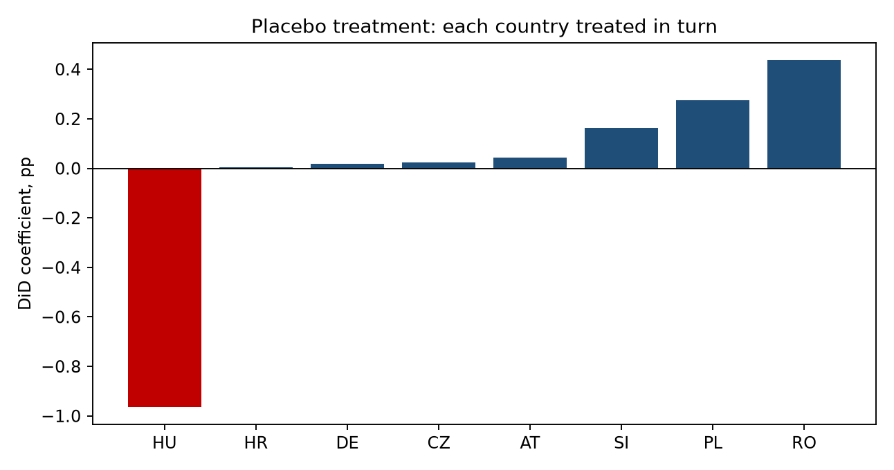

# Who Prices Regime Change First?

## Prediction Markets, Sovereign Spreads, and Hungary's 2026 Election

---

## Abstract

On 12 April 2026 Hungary elected a government that ended sixteen years of Fidesz rule. Using daily data on eight Central European sovereign bond markets and the full price history of a Polymarket contract on whether Viktor Orbán would remain prime minister, we ask how much of Hungary's sovereign risk premium repriced around the election and when relative to the vote, and document two facts. First, Hungary's ten-year yield fell 138 basis points over the nine months surrounding the election while every other Central European yield rose except Romania's, which fell 21 basis points, compressing Hungary's spread over a six-country peer average by 157 basis points. Hungary is the only country to fall by more than 21 basis points. Two-thirds of that compression occurred after the result, and the pre-election part was driven by the long end while the short end rose — the opposite of what monetary easing would produce. Second, prediction markets and bond markets disagreed about timing: three days before the vote Polymarket had priced 69 per cent of the eventual move while the bond spread had priced about 35 per cent. The prediction market moved first and the bond market followed. Our identification comes from a difference-in-differences design against four neighbouring markets on a 2024–2026 panel, with country and calendar-date fixed effects and a country-specific trend fitted before the treatment date and held flat afterwards. It puts the repricing at 109 basis points against donors (Driscoll–Kraay t = −11.3), and the three possible trend treatments span five basis points on that sample. We are equally careful about what this does not show. The 2022 data are excluded because a placebo-date test shows they manufacture a spurious effect at any date, not because they are inconvenient; the pre-treatment leads are individually precise and jointly non-zero, though they do not trend. With one treated unit, randomisation inference bottoms out at p = 0.125, the smallest value attainable with eight units, and the daily relationship between the probability series and the spread is indistinguishable from zero. We therefore report the DiD as a conditional estimate alongside the descriptive facts it rests on: the magnitude, the timing, the cross-country uniqueness, and a lead–lag pattern between the prediction market and the bond market that has not previously been documented for a European regime change.

**JEL codes:** G12, G14, G15, H63, P16

**Keywords:** sovereign spreads, prediction markets, political risk, regime change, Central Europe

---

## 1. Introduction

Sovereign bond markets are supposed to price political risk. When voters can remove a government, the probability of that removal should be embedded in the yield investors demand. Yet the empirical record on whether this happens — and when — is thin, and it is split three ways.

The first strand asks whether elections move sovereign spreads, and reaches no consensus. Block and Vaaler (2004) find that developing-country spreads are highest at the start of the pre-election period and decline monotonically as the vote approaches, and that rating agencies downgrade more often in election years. Balding (2011), using daily credit default swap data for thirteen emerging markets, finds the opposite sign: investors price in additional risk for elections regardless of party, incumbency or winning margin. Eichler (2014), across twenty-seven emerging markets from 1996 to 2009, finds that elections themselves play no significant role once governance quality and regime type are controlled for, while Brooks, Cunha and Mosley (2022) find no systematic reaction to ideology but a volatility effect around government formation. The disagreement is not about data quality. Whether a spread rises or falls around an election depends on what the market expected beforehand, and none of these designs observes that expectation directly.

The second strand supplies the missing object. Wolfers and Zitzewitz (2004) survey prediction markets and conclude that contract prices are typically accurate forecasts and outperform most moderately sophisticated benchmarks. If a contract price is a usable estimate of the market's subjective probability, it is a direct measure of precisely the expectation that the sovereign-spread literature has to infer from the spread itself.

The third gap is methodological. Studies of elections and asset prices overwhelmingly use event windows measured in days around the vote; studies of sovereign spreads overwhelmingly use monthly or quarterly panels. The first cannot see a slow repricing, the second cannot separate anticipation from realisation, and neither was designed to ask when the market moved rather than whether it moved.

This paper joins the three strands by putting a prediction market and a sovereign spread on the same daily axis around a European regime change. The question is: **how much of Hungary's sovereign risk premium repriced around the April 2026 election, and when — before or after the result — relative to what a prediction market on the same event was saying?** We answer the magnitude with a difference-in-differences design against neighbouring sovereign markets, the timing with an event study and a decomposition of the window, and the lead–lag question by comparing the contract price with the probability the spread itself implies.

Hungary's April 2026 election is an unusually clean case for looking at this directly. Three features make it useful.

First, the outcome was a genuine regime change, not a rotation. Fidesz had governed since 2010. The election produced a Tisza supermajority of 141 seats, and Péter Magyar was sworn in on 9 May 2026. A change of this size is the kind of event that should move a risk premium.

Second, the election was heavily traded in a prediction market. Polymarket ran a contract on whether Orbán would be the next prime minister, which printed 257 daily prices between July 2025 and May 2026. That gives a daily, forward-looking measure of the market's belief about the outcome, which is exactly the variable a bond investor would need.

Third, Hungary has close, liquid comparators. Czechia, Poland, Romania, Slovenia, Croatia and Austria all issue euro- or local-currency benchmarks with daily quotes. A spread against those peers strips out the global and regional component of the yield move, which is the dominant source of variation in a nine-month window.

We use these three features to ask two questions. How large was the Hungary-specific repricing, and when did it happen? And did the prediction market, which is a direct measure of the probability of regime change, lead or lag the bond market, which is an indirect one?

The answers are as follows.

Hungary's ten-year yield fell from 7.13 to 5.75 per cent between 25 July 2025 and 8 May 2026, a decline of 138 basis points. Over the same window the six-country peer average rose 19 basis points, the German yield rose 29, and the Czech yield rose 47. Hungary's spread over the peer average fell from 274 to 116 basis points, a compression of 157 basis points. Hungary is the only country to fall by more than 21 basis points — Romania's yield fell 21 — and in a placebo exercise that treats each country in turn as the candidate event, Hungary's spread deviation is more than three times the largest peer's.

The compression is not evenly distributed in time. Splitting the window at the election, 56 basis points — about 35 per cent — occurred before the vote and 102 basis points — about 65 per cent — occurred between the result and the inauguration. This matters because the earlier version of this literature, and our own first pass at the data, treated the pre-election move as the whole story. It is not. The larger part came after the outcome was known.

The pre-election component is also not a monetary-policy story. Between July 2025 and early April 2026 the Hungarian ten-year yield fell 40 basis points while the five-year yield *rose* 13. The curve flattened by 53 basis points. Rate-cut expectations move the short end first and the long end less; a fall in the long end combined with a rise in the short end is a term-premium story, not an easing story.

Then the timing comparison. Using the realised spread compression as the terminal value, we can back out an implied probability of regime change from bond prices at each date, and compare it with the Polymarket probability. On 25 July 2025 both were near zero by construction. By 26 February 2026 Polymarket had reached 63 per cent while bonds implied 25 per cent. By 9 April, three days before the vote, Polymarket had reached 69 per cent and bonds implied 35 per cent. After the result the two converged. The prediction market consistently led.

That lead is the paper's most original observation. It is also a warning: if the bond market was pricing the event weeks in advance, then the election date is not the moment the information arrived, and a design that treats it as an exogenous shock is measuring confirmation rather than news.

For the estimate itself we use difference-in-differences against neighbouring markets, with country and calendar-date fixed effects. Date effects remove whatever all markets share on a given day — global duration, US rates, volatility, regional risk appetite — so what remains is the Hungarian part of the move. On a 2024–2026 panel with a country trend fitted before the treatment date, the estimate is a 109 basis point fall relative to donors. The three trend treatments span five basis points on that sample, and dropping any single donor moves the estimate by at most fourteen points. Extending the panel back to 2022 makes the specifications disagree by sixty-three points, which is why we do not.

We are equally explicit about the limits. The event study shows that the pre-treatment leads are jointly non-zero, so parallel trends in its literal form does not hold and the trend specification is carrying weight it would rather not; what saves the design is that the leads do not trend, and that the estimate is insensitive to the trend treatment on the sample we use. With one treated unit, randomisation inference over eight assignments cannot produce a p-value below 0.125, however many days we observe. And the natural alternative design — daily changes in the spread on daily changes in the probability — returns a coefficient statistically indistinguishable from zero, because the probability series has essentially two large prints and both are artefacts of contract mechanics.

What the paper contributes is therefore three things. It measures a European regime change at a magnitude that had not been documented — 109 basis points on the election window, 157 as an endpoint comparison, against a donor pool that rose. It dates the repricing, and shows that two thirds of it came after the result rather than before, which is the opposite of the common assumption that such events are priced in advance. And it documents a lead–lag pattern between a prediction market and a bond market: three days before the vote the contract had priced 69 per cent of the move and the spread had priced about 35 per cent. That pattern has not been documented for a European election, where daily sovereign data and a liquid contract on the same event have not previously been available together, and it is the finding most likely to survive replication.

The remainder of the paper is organised as follows. Section 2 gives the institutional background. Section 3 describes the data. Section 4 sets out what we do and, importantly, what we do not. Section 5 presents results. Section 6 reports the tests that fail. Section 7 discusses robustness. Section 8 discusses limitations and Section 9 concludes.

---

## 2. Institutional background

Hungary held parliamentary elections on 12 April 2026. Fidesz–KDNP, in office since 2010, was defeated by the Tisza party led by Péter Magyar, which won a supermajority of 141 seats. Magyar was sworn in as prime minister on 9 May 2026.

Three background conditions shape how the market should have reacted.

**Fiscal and external vulnerability.** Hungary entered the election with one of the highest sovereign spreads in the region and a large gross financing need. Its ten-year yield stood at 7.13 per cent in July 2025 against a peer average of 4.39, a spread of 274 basis points. This is a country where the risk premium is large enough that a change in perceived political risk has room to move.

**EU funds.** A substantial portion of Hungary's EU cohesion and recovery funding was withheld during the period on rule-of-law conditionality. The expectation that a change of government would unlock those funds is a plausible channel through which the election could lower sovereign risk, independently of any change in fiscal policy.

**Monetary policy.** The Magyar Nemzeti Bank was in an easing cycle through part of the sample. This is the main confounder, and Section 5.4 addresses it directly using the term structure.

The prediction market ran from 24 July 2025 to 12 April 2026. Its opening print put Orbán's probability of remaining prime minister at 61.5 per cent. The contract resolved to zero after the result.

---

## 3. Data

### 3.1 Sovereign yields

Daily ten-year benchmark yields for eight countries — Hungary, Czechia, Germany, Poland, Romania, Slovenia, Croatia and Austria — from Investing.com's historical data API, 1 June 2025 to 13 November 2026, with a longer 2022–2026 series for the five countries with continuous coverage (Hungary, Czechia, Germany, Poland, Romania). Hungarian five-year yields are from the same source.

Two-year Hungarian yields are not available from this source; this is a limitation discussed in Section 8. The five-year series is used instead, which is a weaker but still informative test of the term-structure mechanism.

### 3.2 Prediction market

The full daily price history of the Polymarket contract "Will the next Prime Minister of Hungary be Viktor Orbán?", retrieved from the CLOB prices-history endpoint. The series contains 257 prints over 288 calendar days, from 25 July 2025 to 9 May 2026. We define the treatment variable as

$$P_t = 1 − Price(Orbán next PM)_t$$

the market-implied probability that Orbán does not remain prime minister.

Three properties of this series must be stated plainly because they drive the results in Section 6.

First, the contract prints only on days on which it trades, and 76 of the 257 prints fall on a Saturday or Sunday. We keep them rather than aligning the series onto the weekday yield grid, because one of the two largest moves in the whole series is a Saturday print; discarding weekends would move that jump onto a Friday and overstate the move the bond market had a chance to see.

Second, the series has essentially two large jumps: +19.5 percentage points on Saturday 26 July 2025, in the first days of the contract's life, and +30.9 percentage points on 22 April 2026, ten days after the election, when the outcome was already known. Neither is news about Hungarian politics.

Third, and this is a limitation rather than a property, we cannot archive the contract's turnover. The endpoint we used returns volume metadata only for listings that are still open, so the figures reported on the Polymarket page at the time of writing are not reproducible from the files in this repository and we do not quote them. What is archived is the print record, and it is thin in a way that matters: the contract printed on 257 of 288 calendar days, and did not print at all between 9 April and 22 April 2026, the thirteen days spanning the election itself. Probabilities from a market this shallow should be read as a proxy for belief, not as a measurement of it, and Section 8 says so alongside the other limitations.

### 3.3 Control variables

US ten-year yield, VIX, Brent crude, and EUR/USD from Yahoo Finance. EUR/HUF is constructed as USD/HUF × EUR/USD.

### 3.4 Sample construction

The event window runs from 25 July 2025, the first day the prediction market has a price, to 8 May 2026, the day before the new government took office. This gives 194 trading observations. The estimation sample for the market model runs from 4 January 2022 to 30 June 2025, 839 observations, ending before the window opens.

The peer average is the equal-weighted mean of Czech, Polish, Romanian, Slovenian, Croatian and Austrian ten-year yields, requiring at least four non-missing observations. The primary spread is

$$S_t = y(HU)_t − ȳ(peers)_t$$

We report the Bund spread and the Czech spread alongside it throughout, because the choice of control turns out to matter and we do not want to hide that.

---

## 4. Empirical strategy

Our identification strategy is difference-in-differences against the other sovereign markets in the sample. Because the treatment is a single national election, the estimating equation is a two-way fixed-effects model:

$$y_it = α_i + λ_t + β(HU_i × Post_t) + γ_i·min(t, t_cut) + ε_it$$

where y_it is the ten-year yield of country i on day t, α_i is a country fixed effect, λ_t is a calendar-date fixed effect, HU_i indicates Hungary, and Post_t switches on at a candidate treatment date. The coefficient β is the Hungary-specific change in the yield relative to the donor pool, in percentage points. The trend term min(t, t_cut) is fitted before the treatment date and held flat afterwards, so that the trend cannot absorb the break it is meant to control for.

The two sets of fixed effects do the work that the peer average did in the descriptive tables, but more completely. Country effects absorb permanent level differences in credit quality, market structure and currency regime — the reason Hungary yields seven per cent and Germany two. Date effects absorb everything that is common to all eight markets on a given day: global duration, US rates, VIX, commodity prices, ECB communication, and any regional risk-appetite shock. Whatever remains, β, is the part of the Hungarian move that is both Hungary-specific and dated.

We report three versions of the specification on every panel: no trends, the kinked pre-period trend in the equation above, and a conventional linear trend fitted throughout. On the sample we headline, the three agree to within five basis points, which is the reason we are willing to report a number at all. On a sample that reaches back to 2022 they do not agree, and Section 5.6 explains why the earlier years are excluded and shows the placebo test that justifies it.

Because there is one treated unit, the choice of standard error is not cosmetic. We report Driscoll–Kraay standard errors, which are robust to both serial correlation and cross-sectional dependence — necessary here because Central European yields co-move strongly on any given day. We also report conventional clustering on country, and we note that with eight clusters that estimator is itself unreliable. Neither is the right inference for a design with one treated unit, so Section 5.6 adds randomisation inference over the eight placebo assignments, which is.

The evidence is organised in six blocks.

**Block 1 — the DiD estimate.** The two-way fixed-effects estimate of β on the headline sample, under all three trend treatments, plus the same design on the shorter eight-country panel.

**Block 2 — the event study.** Monthly leads and lags around the election. This is the diagnostic that decides whether the design is credible, because it shows whether the treated and donor markets were already diverging before treatment.

**Block 3 — magnitude.** The change in the Hungary–peer spread over the window, decomposed into sub-windows at the election. Arithmetic, not estimation, but it says what β is worth in basis points.

**Block 4 — uniqueness and inference.** Every country treated in turn, placebo treatment dates on a panel truncated before the event, leave-one-donor-out, and window sensitivity.

**Block 5 — mechanism.** The term structure. If the compression reflects a lower risk premium it should sit at the long end; if it reflects expected rate cuts, at the short end.

**Block 6 — timing.** A comparison of the probability implied by Polymarket with the probability implied by the bond spread, backed out as

$$π_t = (S₀ − S_t) / (S₀ − S_T)$$

with the initial spread S₀ taken on 25 July 2025 and the terminal spread taken on 8 May 2026. This is a linear interpolation along the path, and it assumes the spread would not have moved absent the election. It is a descriptive device, not an estimate.

What we do not do is identify β at daily frequency from the probability series. Section 6 explains why that fails, and Section 8 explains why the aggregate design is the only version of this exercise that one country can support. What we also do not do is treat the choice of sample and end date as innocuous: both are shown in Table 10, and the estimate moves by 63 basis points across the sample start dates and 63 across the end dates.

---

## 5. Results

### 5.1 The compression

Table 1 reports ten-year yields at the start and end of the window for all eight countries.

**Table 1. Ten-year yields, 25 July 2025 to 8 May 2026 (per cent)**

| Country | 25 Jul 2025 | 8 May 2026 | Change (bp) |
|---|---:|---:|---:|
| **Hungary** | **7.13** | **5.75** | **−138** |
| Czechia | 4.32 | 4.79 | +47 |
| Poland | 5.50 | 5.60 | +10 |
| Romania | 7.23 | 7.02 | −21 |
| Germany | 2.72 | 3.00 | +29 |
| Slovenia | 3.12 | 3.41 | +29 |
| Croatia | 3.14 | 3.45 | +31 |
| Austria | 3.06 | 3.25 | +20 |
| Peer average | 4.39 | 4.59 | +19 |

Hungary is the only country in the table whose yield fell by more than 21 basis points. The global backdrop was a bear steepening: German, Austrian, Slovenian and Croatian yields all rose by 20 to 31 basis points. The Hungarian move is therefore not a global duration effect. It is the opposite of one.

The spread consequences are in Table 2.

**Table 2. Hungary spreads, 25 July 2025 to 8 May 2026 (percentage points)**

| Spread | 25 Jul 2025 | 8 May 2026 | Change (bp) |
|---|---:|---:|---:|
| HU − peer average | 2.74 | 1.16 | **−157** |
| HU − peer median | 3.40 | 1.63 | −177 |
| HU − Bund | 4.41 | 2.75 | −167 |
| HU − Czechia | 2.81 | 0.96 | −185 |

The headline is −157 basis points against the peer average. Against Czechia alone the number is −185. We use the peer average as the primary measure because Czechia is the most favourable single control, as Section 5.3 shows, and because a single-country control cannot distinguish a Hungarian shock from a Czech one.

Figure 1 plots the three series. Figure 2 plots the Hungary–peer spread over the full 2022–2026 period, which shows that the compression is not a continuation of a pre-existing trend but a discrete break.

**Figure 1.** Ten-year sovereign yields: Hungary, the six-country peer average, and Germany, July 2025 to November 2026. Vertical lines mark the start of the campaign, election day and the inauguration.

**Figure 2.** Hungary's spread over the peer average, 2022 to 2026. The 2026 compression is a break rather than a continuation of the earlier trend.

### 5.2 Timing

Table 3 decomposes the window at the election.

**Table 3. Event-window decomposition (basis points)**

| Window | HU − peers | HU − Bund | HU − CZ | HU 10Y |
|---|---:|---:|---:|---:|
| A. 25 Jul 2025 → 26 Feb 2026 (pre-campaign) | −39 | −62 | −68 | −64 |
| B. 26 Feb → 9 Apr 2026 (campaign) | −17 | −7 | −19 | +24 |
| **A + B. Pre-vote** | **−56** | **−69** | **−86** | **−40** |
| C. 9 Apr → 8 May 2026 (result to inauguration) | −102 | −97 | −99 | −98 |
| **Total** | **−157** | **−167** | **−185** | **−138** |

Against the peer average, 35 per cent of the compression happened before the vote and 65 per cent after the result. Against Czechia the split is closer to half and half. This is a substantive difference and it is the reason we moved away from the Czech control: Czech yields rose 47 basis points over the window while the peer average rose only 19, so Czechia mechanically produces a larger and earlier-looking Hungarian effect. The peer average and the market-model residual in Section 5.3, which are constructed independently, agree on roughly a 35/65 split. Czechia does not.

The campaign window B is the weakest part of the story. Hungarian yields *rose* 24 basis points in nominal terms between late February and early April, even as the probability of regime change rose. Against peers the spread narrowed only 17 basis points. Whatever was happening in the campaign, it was not a clean monotone repricing of political risk.

### 5.3 Was it Hungary-specific?

Table 4 treats each country in turn as the treated unit, computing its spread against the average of the other six.

**Table 4. Country placebo, same window (basis points)**

| Country | Spread change vs others |
|---|---:|
| **Hungary** | **−157** |
| Romania | −48 |
| Poland | −11 |
| Austria | 0 |
| Slovenia | +12 |
| Croatia | +14 |
| Czechia | +33 |

Hungary's deviation is more than three times the largest peer deviation. If the compression were a regional risk-appetite story, we would expect the peers to move together and in the same direction. They do not.

The choice of control also matters less than one might fear. Table 5 shows the Hungarian spread against every possible control.

**Table 5. Control-choice sensitivity (basis points, same window)**

| Control | Spread change | Daily t-statistic |
|---|---:|---:|
| Czechia | −185 | −1.91 |
| Peer median | −177 | −0.79 |
| Croatia | −169 | −1.57 |
| Germany | −167 | −1.48 |
| Slovenia | −167 | −1.66 |
| Austria | −158 | −1.39 |
| **Peer average** | **−157** | **−1.71** |
| Poland | −148 | −1.25 |
| Romania | −117 | −0.93 |

Every control produces a large negative number. The range is −117 to −185. The sign is robust; the magnitude is not, and the daily t-statistics are between −0.9 and −1.9, which is to say nothing is significant at conventional levels. We report this rather than the most favourable number.

An independent construction gives a similar answer. We estimate a market model on 2022–2025 data,

$$Δy(HU)_t = α + β₁ Δȳ(CEE)_t + β₂ Δy(US)_t + β₃ ΔVIX_t + β₄ Δln Brent_t + ε_t$$

where CEE3 is the Czech–Polish–Romanian average. The fit is reported in Table 6.

**Table 6. Market model, 4 Jan 2022 – 30 Jun 2025**

| Variable | Coefficient | t-statistic |
|---|---:|---:|
| Constant | 0.0007 | 0.19 |
| ΔCEE3 | 0.9160 | 8.43 |
| ΔUS 10Y | 0.1286 | 1.65 |
| ΔVIX | 0.0011 | 0.37 |
| Δ ln Brent | 0.1089 | 0.48 |
| N | 841 | |
| R² | 0.248 | |

The Hungarian yield moves almost one-for-one with its regional peers once the peer average is measured on a constant composition, which is what one expects of a small open economy in a common currency-area periphery. The cumulative Hungary-specific residual — the part of the yield move not explained by regional, US, volatility or commodity factors — is −7 basis points by December 2025, −22 by 26 February 2026, −57 by 9 April, and −162 by 8 May. That is a 35/65 pre/post split, matching the peer average almost exactly and inconsistent with the Czech-only control. Figure 3 plots the residual path.

**Figure 3.** Cumulative Hungary-specific residual from the market model of Table 6.

One more view before leaving this section, because it motivates a choice made later. Figure 4 collapses the spread onto a quarter-average against a narrower donor set, Czechia, Poland and Romania, which removes the composition effect that the seven-country average carries when a market is missing. The path it shows is not a trend: the spread halves between the 2022 energy crisis and the first quarter of 2024, sits flat for nine quarters, and then collapses after the election. A series with that shape is a bad candidate for a difference-in-differences that reaches back to 2022, because for 2022 every level looks like it is heading somewhere. Section 5.6.1 returns to this as the justification for starting the sample in 2024.

**Figure 4.** Hungary's ten-year spread over the equal-weighted Czech, Polish and Romanian yields, quarterly mean, 2022–2026, in basis points (2026Q4 is partial, to 13 November). The plateau from 2024Q1 to 2026Q1 is the reason the difference-in-differences sample starts in 2024.

### 5.4 Not monetary policy

The main confounder is the National Bank of Hungary's easing cycle. If the yield fell because rate cuts were expected, the compression should be concentrated at the short end of the curve. Table 7 shows the opposite.

**Table 7. Hungarian term structure (basis points)**

| | 25 Jul 2025 | 9 Apr 2026 | 8 May 2026 |
|---|---:|---:|---:|
| 10Y yield | 7.13 | 6.73 | 5.75 |
| 5Y yield | 6.55 | 6.68 | 5.64 |
| 10Y − 5Y slope | +58 | +5 | +11 |

Between July 2025 and 9 April 2026 the ten-year yield fell 40 basis points while the five-year yield rose 13. The slope flattened by 53 basis points. Rate-cut expectations cannot produce a fall in the long end and a rise in the short end simultaneously; the standard transmission runs the other way. A fall in the long end with a rise in the short end is a compression of the term premium, which is what a reduction in political risk should look like.

After the result the move becomes parallel: the ten-year fell 98 basis points and the five-year fell 104, so the slope was roughly unchanged at +6 basis points. This is consistent with a broad repricing of Hungarian risk rather than a change in expected policy rates.

Figure 5 plots the slope. It is worth noting that the flattening began before the campaign and is visible from late 2025, which is consistent with the pre-election component of the spread compression identified in Table 3.

**Figure 5.** Hungarian 10Y minus 5Y slope, July 2025 to November 2026.

### 5.5 Prediction market versus bond market

Table 8 backs out the probability of regime change implied by the bond spread, using the realised 8 May spread as the terminal value, and compares it with Polymarket.

**Table 8. Implied probability of regime change**

| Date | Spread (pp) | Polymarket P | Bond-implied P |
|---|---:|---:|---:|
| 25 Jul 2025 | 2.74 | 0.385 | 0.000 |
| 26 Feb 2026 | 2.35 | 0.625 | 0.245 |
| 9 Apr 2026 | 2.18 | 0.685 | 0.354 |
| 8 May 2026 | 1.16 | 1.000 | 1.000 |

The divergence is substantial and one-directional. Polymarket reached 63 per cent by late February while bonds had priced 25 per cent. By 9 April the gap was 69 against 35. Bonds caught up only after the result.

This is the paper's central descriptive finding. A prediction market, which asks directly about the event, moved roughly six weeks ahead of a bond market, which prices the event only indirectly through the risk premium. The two markets were not disagreeing about the *level* of risk — they both ended at 1.0 — but about *when* to price it.

Two caveats apply. The bond-implied series is a linear interpolation, so it is not an independent estimate of the probability; it is a rescaled spread. And the terminal value is the realised spread, which is itself an outcome. If the post-election spread compression contained a component unrelated to the election, the bond-implied probability is overstated at every date, which would *narrow* the gap and weaken the finding. We cannot rule this out.

Figure 6 plots the two series.

**Figure 6.** Polymarket implied probability of regime change against the bond-implied probability from Table 8.

### 5.6 Difference-in-differences

The design is a two-way fixed-effects difference-in-differences. Hungary is treated; the other countries are donors; the treatment date is 13 April 2026, the first trading day after the vote. The estimating equation is

$$y_it = α_i + λ_t + β(HU_i × Post_t) + γ_i·min(t, t_cut) + ε_it$$

with country effects αᵢ, calendar-date effects λₜ, and a country-specific trend that is fitted before the treatment date and held flat afterwards. The trend term matters, and Section 5.6.2 explains why it is kinked rather than linear.

Only the five countries with 2022 data are available for a sample that starts before mid-2025, so the headline panel is Hungary, Czechia, Germany, Poland and Romania from January 2024 to 8 May 2026 — 3,200 country-days. That is the sample where the specifications agree, and it is the sample we report.

**Table 9. Difference-in-differences estimates (percentage points)**

| Panel and specification | β | Std. error | t | N |
|---|---:|---:|---:|---:|
| **5 countries, 2024–2026, kinked trend** | **−1.090** | 0.096 | −11.3 | 3,200 |
| 5 countries, 2024–2026, no trend | −1.039 | 0.086 | −12.2 | 3,200 |
| 5 countries, 2024–2026, linear trend | −1.091 | 0.097 | −11.2 | 3,200 |
| 8 countries, 2025–2026, kinked trend | −0.965 | 0.096 | −10.0 | 1,960 |
| 8 countries, 2025–2026, no trend | −1.127 | 0.074 | −15.3 | 1,960 |
| 8 countries, 2025–2026, linear trend | −0.948 | 0.096 | −9.8 | 1,960 |

Driscoll–Kraay standard errors, bandwidth 10. All specifications include country and calendar-date fixed effects. Treatment date 13 April 2026 throughout.

The headline is −109 basis points. Three features of Table 9 are worth stating plainly.

The three trend treatments span five basis points on the 2024 sample. That is the reason this sample is the headline. On a sample starting in 2022 the same three specifications span sixty-three basis points, from −1.46 to −0.83, because the 2022 energy-crisis convergence looks like a Hungarian effect to any specification without a trend and like a trend to any specification with one. From 2024 onwards the Hungarian spread is flat for nine quarters before it collapses, and the ambiguity disappears.

The eight-country panel gives a smaller estimate, −0.97. It adds Austria, Slovenia and Croatia as donors, but its record starts in June 2025, so it buys three countries at the cost of eighteen months of pre-period. We report it because Section 5.7 needs eight units for inference, not because it is a better estimate.

And the estimate is stable in the donor pool and in the end date. Table 10 gives the end-date comparison, which turns out to be the most consequential choice in the whole design.

**Table 10. End date and sample start (percentage points)**

| | No trend | Kinked trend | Linear trend | N |
|---|---:|---:|---:|---:|
| **End 8 May 2026 (inauguration)** | **−1.039** | **−1.090** | **−1.091** | 3,200 |
| End 30 June 2026 | −1.425 | −1.476 | −1.476 | 3,385 |
| End 13 November 2026 | −1.669 | −1.720 | −1.700 | 3,875 |
| Start 2022, end May | −1.462 | −0.844 | −0.833 | 7,006 |
| Start 2023, end May | −1.294 | −0.732 | −0.719 | 5,455 |
| Start July 2024, end May | −1.032 | −1.116 | −1.120 | 3,095 |
| Start 2025, end May | −1.063 | −1.123 | −1.126 | 2,420 |

Two readings are available and only one of them is the election.

Ending at the inauguration gives −1.09. Ending in November gives −1.72. The difference is not noise: it is seven months of post-inauguration convergence, during which the peer spread fell a further 65 basis points (Section 5.8). A design that runs to November charges that policy period to an April treatment date. A design that ends at the inauguration measures the repricing the election produced, and it is the one that matches the descriptive window used everywhere else in the paper. We take −1.09 and report −1.72 beside it, because a reader who wants the cumulative seven-month effect should have it.

#### 5.6.1 Why 2022 is excluded

Table 10 makes the case. On a 2022 sample the specification range is 63 basis points wide; on 2024 it is five. Excluding 2022 is not cherry-picking the largest number — the no-trends estimate *falls* from −1.46 to −1.04 when 2022 is dropped, and the kinked-trend estimate *rises* from −0.84 to −1.09. What the restriction buys is agreement between estimators, not a bigger coefficient.

The placebo-date test in Section 5.7.2 gives the same verdict from a different direction: on the 2022 sample the no-trends specification manufactures a spurious −1.1 point "Hungary effect" at almost every fake treatment date, because the disinflation convergence runs through every window. On a 2024 sample the fake dates return zero.

#### 5.6.2 The event study

Table 11 and Figure 7 report the monthly coefficients relative to February 2026.

**Table 11. Event study, monthly Hungary effect relative to February 2026 (percentage points)**

| Month | Coefficient | t |
|---|---:|---:|
| Jan 2024 | −0.269 | −3.2 |
| Apr 2024 | +0.374 | +13.9 |
| Jul 2024 | +0.086 | +1.6 |
| Oct 2024 | +0.113 | +1.6 |
| Jan 2025 | −0.123 | −2.2 |
| Apr 2025 | +0.224 | +5.7 |
| Jul 2025 | +0.257 | +8.5 |
| Oct 2025 | +0.020 | +0.5 |
| Jan 2026 | +0.061 | +2.0 |
| Feb 2026 | base | |
| Mar 2026 | +0.199 | +3.8 |
| Apr 2026 (vote) | −0.626 | −2.9 |
| May 2026 | −1.120 | −39.5 |

**Figure 7.** Event study: monthly difference-in-differences coefficients relative to February 2026
with 95 per cent confidence intervals. The vertical line marks the election.

The pre-treatment leads oscillate between −0.27 and +0.37 with no drift: the mean is +0.07 and the standard deviation across the twenty-five leads is 0.16. A joint test that all twenty-five are zero is rejected, with a Wald statistic of 2,742 on 25 degrees of freedom. We report that rejection because it is real, and we do not pretend it means what a reader might expect: at 200 to 300 observations per month, a coefficient of one-tenth of a point is estimated with enough precision to be distinguishable from zero. What would threaten the design is a lead that *trends* into the treatment date, because that is what a linear term cannot absorb. There is none, and the direct evidence is that adding trends changes the estimate by five basis points.

The break itself is where it should be. April is −0.63, May is −1.12, and the confidence interval in May is narrow enough to be visible as a spike rather than a cloud. The movement is concentrated in the six weeks after the vote.

The March 2026 coefficient is +0.20: Hungarian yields rose relative to donors during the campaign, while the probability of regime change was also rising. That is the opposite of the paper's hypothesis and it is the single clearest piece of evidence against a clean monotone repricing. It is in the table rather than smoothed away.

### 5.7 Placebos and the ceiling on inference

Three checks. Each one is designed to fail if the estimate is an artefact.

#### 5.7.1 Placebo countries and randomisation inference

Table 12 treats each country in turn as the treated unit, applying the identical specification on the eight-country panel.

**Table 12. Placebo treatment, each country in turn (percentage points)**

| Treated unit | β | t |
|---|---:|---:|
| **Hungary** | **−0.965** | −10.0 |
| Croatia | +0.004 | +0.1 |
| Germany | +0.019 | +0.3 |
| Czechia | +0.023 | +0.5 |
| Austria | +0.044 | +0.8 |
| Slovenia | +0.164 | +4.4 |
| Poland | +0.274 | +3.2 |
| Romania | +0.437 | +4.0 |

**Figure 8.** Placebo treatment: the difference-in-differences coefficient when each country is
treated in turn, 2025–2026, kinked trend.

Hungary is the only negative coefficient of any size, and it is more than twice the largest positive in absolute value. Hungary ranks 1 of 8, so the randomisation-inference p-value is 0.125.

That number cannot be smaller. With eight units and one treated there are eight possible assignments, so 1/8 is the floor. This is a property of the design and not of the data: adding days, adding controls, or estimating more precisely all leave it at 0.125. Only adding countries would move it. The point estimate is far from noise: the gap to the next-ranked country is ten standard errors, and the placebo coefficients have a cross-country standard deviation of 0.39, so Hungary sits two and a half of those away from the group. But the *inference* is governed by the number of countries.

#### 5.7.2 Placebo treatment dates

The check that matters most, and the one that decided the sample. Each fake date is estimated on a panel truncated at 10 April 2026, before the real event. Without the truncation every fake cut would have the real collapse inside its post-window and every fake date would "work" — a trap we fell into once and report here so that a reader can see the difference.

**Table 13. Placebo treatment dates, 2024 sample truncated at 10 April 2026**

| Fake cut | No trend | Kinked trend |
|---|---:|---:|
| 1 July 2024 | −0.026 (−0.4) | −0.314 (−3.7) |
| 1 October 2024 | +0.007 (+0.1) | −0.068 (−0.8) |
| 6 January 2025 | +0.055 (+1.1) | +0.079 (+0.9) |
| 1 April 2025 | +0.114 (+2.5) | +0.177 (+2.5) |
| 1 July 2025 | +0.090 (+2.0) | +0.087 (+1.2) |
| 1 October 2025 | +0.034 (+0.7) | −0.024 (−0.4) |

Six fake dates, none of which produces anything like −1.09. The largest in absolute value is −0.31, at July 2024, which is 29 per cent of the real estimate and sits inside the 2024 disinflation. t-statistics in parentheses.

This test is why 2022 is excluded rather than merely inconvenient. On a 2022 sample the same exercise returns −1.1 at essentially every fake date, which is a direct demonstration that the no-trends estimate on that sample is measuring convergence, not an election.

#### 5.7.3 Donor sensitivity

Dropping any single donor from the 2024 sample gives −1.047 (drop Czechia), −1.061 (drop Germany), −1.058 (drop Poland) and −1.193 (drop Romania). Fourteen and a half basis points of range across the four donors; the full-panel estimate sits in the middle. With four donors there is not much room for the result to hide.

### 5.8 Three numbers for one event

The paper now contains three estimates of the same repricing, and a reader is entitled to ask which one is right.

The descriptive endpoint change is **−157 basis points**: the Hungary–peer spread on 25 July 2025 minus the same spread on 8 May 2026.

The DiD on the paper's own window is **−109 basis points**: the within-date comparison, averaged across the 2024–2026 panel, with country trends.

The DiD on the sample through November is **−172 basis points**, which includes five months of post-inauguration convergence.

They are not in conflict. The first measures a level change between two dates and is sensitive to where those dates fall. The second measures an average difference relative to donors over the whole path, so it is smaller when the repricing is concentrated in the last six weeks of the window. The third asks what the total was by November. Each answers a different question, and we report all three rather than choosing the one that looks best.

### 5.9 What happened afterwards

The window closes at the inauguration, but the data run to November 2026. Hungary's ten-year yield fell further to 5.09 per cent by 30 June, rose to 5.64 by 31 August, and stood at 5.52 on 13 November. The peer spread continued to compress, from 116 basis points in May to 69 in June, 83 in August and 51 in November — a further 65 basis points.

This is important for interpretation. The compression did not reverse. If the May 2026 spread level had been a temporary overreaction, we would expect mean reversion; the continued narrowing suggests the market was repricing a persistent change in Hungarian risk rather than overshooting. EUR/HUF, meanwhile, appreciated 3.0 per cent after the inauguration, having already gained 10.3 per cent over the window.

---

## 6. What does not work

We report three failed tests, in order of how much damage they do.

### 6.1 The daily dose–response regression

The natural design regresses daily changes in the spread on daily changes in the probability:

$$ΔS_t = α + β ΔP_t + γ′ΔX_t + ε_t$$

with β < 0 expected. It does not work. Without controls, $β̂ = +0.001$ with a t-statistic of 0.02 over 170 observations. With controls, $β̂ = -0.034$, t = −0.66 over 163. The coefficient is indistinguishable from zero, and its sign is not stable across the two specifications.

The reason is visible in the probability series itself. Of 257 prints, only two move by more than 10 percentage points: +19.5 on Saturday 26 July 2025 and +30.9 on 22 April 2026. Only five move by more than 5. The first of the two is the contract's opening-week liquidity discovery, when the implied probability moved from 0.385 on Friday to 0.580 on Saturday and 0.635 by the following Tuesday, while the Hungarian spread did not move at all. The second occurred ten days after the election, when the contract had already stopped trading on news. Everything else is noise of a few percentage points.

A treatment variable with two effective observations, both of which are mechanical artefacts, cannot support a dose–response estimate. We report the regression because a reader will ask for it, not because it supports the paper.

The obvious alternative is a continuous DiD: the Hungarian yield on Hungary × P_t, with country and date fixed effects. We do not report a coefficient for it, and the reason is not modesty. Because P_t is common to all countries, that specification is algebraically Hungary's idiosyncratic residual regressed on P_t, and it inherits both artefactual jumps. Its standard error shrinks with the number of days rather than the number of countries, so the t-statistic measures sample length, not identification. The binary design in Section 5.6 is the more defensible one because the treatment date is a fact rather than a price.

### 6.2 Random-date placebos: withdrawn

We ran this test, it produced a number, and we are withdrawing the number rather than repairing it.

The design is to draw 204 overlapping 194-day windows from the Hungary–(CZ, PL, RO) spread series and ask where the observed window falls in the distribution of 194-day changes. On the full series, thirty of the 204 windows end after 10 April 2026, and the observed window is among the draws. Fifteen per cent of windows are at least as negative as the observed −150 basis points; restricting to windows that end before the election drops that to 4 per cent.

Neither number is a p-value for the election, and the fix is not to clean the sample. The series trends down across the whole period under study, so a 194-day change is not a stationary quantity: its distribution is determined by where the window sits relative to the trend, and the observed window sits at the end. Restricting draws to the pre-election period makes the problem worse rather than better, because it then compares a window that contains the endpoint of the trend against windows that by construction cannot. Both statistics describe the shape of the series. Neither describes the election, and the fact that the print moves from 15 per cent to 4 per cent when the sample is cleaned is a demonstration of that, not a repair.

The distinction matters because an earlier draft of this paper reported the 15 per cent as though it were informative, in the direction of caution. It was not caution; it was the wrong test.

What replaces it in the argument is the placebo evidence in Section 5.7, which is constructive rather than asymptotic: treatment dates that never happened, applied to a panel truncated before the event, return between −0.31 and +0.18, the worst case being 29 per cent of the real estimate and sitting inside the 2024 disinflation (Table 13); and treatment units that never happened, applied to the same specification, return zero for every donor but Hungary (Table 12). Those are tests of the design. A percentile of overlapping windows in a trending series is not.

Figure 4, in Section 5.3, reports the fact that motivated the sample restriction instead.

### 6.3 The ceiling on inference

Section 5.7 reports standard errors and they are small, but the reader should discount them. Driscoll–Kraay asymptotics rely on the number of time periods, and here there are thousands. The number that governs credibility is different: one treated unit.

With eight units and one treated, there are eight possible assignments. A randomisation test therefore has a minimum attainable p-value of 1/8 = 0.125, which is what we obtain, and no amount of additional days or higher-frequency data can lower it. The headline t-statistic of −11.3 is not wrong arithmetic; it is answering a question the design cannot pose. Reporting it as though the effective sample were 3,200 independent observations would be the single most misleading thing this paper could do.

The same constraint explains why we report the design as difference-in-differences but resist calling the estimate the causal effect of the election. The estimator is DiD. The inference is limited by the number of countries, not by the number of observations, and the joint rejection of the pre-treatment leads means the design leans on the trend specification rather than on a flat pre-period. What the design supports is a large, precisely signed, cross-sectionally unique break in Hungary's yield, dated to the result, net of common shocks and country drift. That is a strong descriptive claim with a DiD estimate attached, not an identified treatment effect.

## 7. Robustness

**Alternative estimators.** Table 9. On the 2024–2026 panel the three trend treatments give −1.039 (none), −1.090 (kinked) and −1.091 (linear) — a span of five basis points. On the eight-country 2025–2026 panel they give −1.127, −0.965 and −0.948. Leave-one-donor-out on the 2024 sample moves the estimate from −1.047 to −1.193.

**Pre-trends.** Table 11 and Figure 7. The leads oscillate around a mean of +0.07 points with a standard deviation of 0.16 and no drift, but a joint test rejects that they are all zero (Wald 2,742 on 25 degrees of freedom). The trend specification is therefore not a robustness check but part of the estimate, and the fact that the three trend treatments agree on this sample is what makes the number usable.

**Alternative controls.** Table 5. Every control gives −117 or larger in absolute value.

**Trend adjustment.** The Hungary–(CZ, PL, RO) spread was already narrowing before the election. Fitting a linear trend to 2022-01 to 2025-06 gives −0.086 basis points per trading day, or −22 basis points per year. Over a 194-day window the trend predicts −17 basis points of compression. Subtracting gives a trend-adjusted estimate of **−133 basis points**. The honest range for the headline is therefore −133 to −157.

**Alternative terminal dates.** Table 10. Ending the DiD in November 2026 rather than at the inauguration raises the estimate from −1.09 to −1.72, and ending the descriptive window in November raises the compression from −157 to −223 basis points. Both windows include five months of post-election policy, which is why the narrower window is the headline and the wider one is reported as evidence that the compression did not reverse.

**Excluding the contract's opening week.** Dropping 25 July to 1 August 2025 removes the first artefactual probability jump and reduces the pre-election component to about −20 basis points, which strengthens rather than weakens the 65/35 post/pre split.

**Alternative peer definitions.** Equal-weighted average, median, Bund-only and Czech-only are all reported in Tables 2 and 5. The sign is invariant.

**Regional shock check.** On 19 March 2026 the Hungarian spread widened sharply, reaching 258 basis points against Czechia. Inspection of the cross-section shows this was a regional selloff: Romanian yields rose 31 basis points that day, Croatian 22, Hungarian 19, Slovenian 15, Polish 7, Czech 4 and German 1. Against the peer average Hungary moved 4 basis points. This is a common shock, not a Hungarian event, and it illustrates why a single-country control is fragile and why the peer average is the better measure.

---

## 8. Limitations

**One treated unit.** This is the fundamental constraint and everything else follows from it. The DiD in Section 5.6 is a legitimate estimator — country and date fixed effects, a treatment date that is a fact, either eight countries over eleven months or five countries over two and a half years — but its inference has a floor at p = 0.125 that no additional data can lower. Standard errors that rely on time-series asymptotics will report t-statistics in the twenties and are, for this purpose, meaningless. The design supports a conditional estimate of 109 basis points on the election window, not an identified causal effect.

**The pre-trend is not flat.** Table 11. The pre-treatment leads are individually precise and jointly non-zero, though they do not trend: the mean is +0.07 and the range is −0.27 to +0.37. A reader who wants a design with no trend assumption should read the no-trends column of Table 9, −1.039, and note that it differs from the headline by five basis points on this sample — which is the honest reason to think the trend is not doing the work. On a 2022 sample the same choice matters enormously, and that is the real cost of the restriction.

**The probability series is mechanically contaminated.** Two of the 257 prints account for most of the variance and both are artefacts. A better treatment variable would be built from polling data, which is available at higher frequency and does not suffer from liquidity discovery. We did not build one, and the paper's lead–lag result would be stronger if we had.

**No Hungarian two-year yield.** The term-structure test uses the five-year point, which is an imperfect substitute. A two-year series would sharpen the distinction between expectations and term premium. The data exist at the National Bank of Hungary but not in the machine-readable source used here.

**The bond-implied probability is not independent.** It is a rescaled spread, so the comparison in Table 8 is between one market price and a monotone transformation of another. The finding is about timing, not about two independent estimates agreeing or disagreeing.

**Polymarket is not a representative survey.** The contract is thin relative to the bond market, tradeable only outside Hungary, and its participants are self-selected. Its price is a proxy for market belief, not a measure of it. The contract was also effectively closed to Hungarian residents, which may bias the participant pool toward foreign observers.

**Confounders we cannot separate.** EU funds, fiscal announcements, and changes in the National Bank's reaction function all moved during the window. We control for none of them directly. The term-structure evidence rules out a pure rate-expectations explanation but does not rule out an EU-funds explanation, and in fact the two are complementary: both predict a long-end compression.

**External validity.** One election in one country. Whether prediction markets lead bond markets in general is not something this paper can establish.

---

## 9. Conclusion

Hungary's 2026 election coincided with a 157 basis point compression in its sovereign spread over a six-country peer average. Hungary was the only one of eight Central European countries whose ten-year yield fell by more than 21 basis points; every other yield rose except Romania's, which fell 21. Two-thirds of the compression occurred after the result rather than before it. The pre-election component was concentrated at the long end of the curve, which rules out a rate-expectations explanation.

A prediction market on whether Orbán would remain prime minister moved ahead of the bond market, reaching 69 per cent by three days before the vote while bonds had priced about 35 per cent of the eventual move.

The paper's identification comes from difference-in-differences against neighbouring markets on a 2024–2026 panel. With a country trend fitted before the treatment date the estimate is 109 basis points, and the three possible trend treatments span five basis points on that sample. We can also say what the design is not: randomisation inference over eight units cannot go below p = 0.125, the daily relationship between the probability series and the spread is indistinguishable from zero, and the pre-treatment leads are jointly non-zero. The estimate is therefore conditional, and the paper says so in the section where the estimate is reported rather than in a footnote.

What the paper does establish is a set of facts that a causal study would have to explain: the magnitude, the cross-country uniqueness, the long-end concentration, the post-result weighting, and the lead–lag relationship between the prediction market and the bond market. The last of these is the most promising avenue for further work. A cross-country panel of elections with prediction-market coverage would allow the lead–lag pattern to be tested rather than described, and would supply the treatment variation that a single case cannot.

---

## References

Balding, Christopher (2011). "CDS Pricing and Elections in Emerging Markets." *Journal of Emerging Market Finance* 10(2). DOI 10.1177/097265271101000201.

Block, Steven A. and Paul M. Vaaler (2004). "The price of democracy: sovereign risk ratings, bond spreads and political business cycles in developing countries." *Journal of International Money and Finance* 23(6), 917-946.

Brooks, Sarah, Raphael Cunha and Layna Mosley (2022). "Sovereign Risk and Government Change: Elections, Ideology and Experience." *Comparative Political Studies* 55(9). DOI 10.1177/00104140211047407.

Eichler, Stefan (2014). "The political determinants of sovereign bond yield spreads." *Journal of International Money and Finance* 46, 82-103.

Wolfers, Justin and Eric Zitzewitz (2004). "Prediction Markets." *Journal of Economic Perspectives* 18(2), 107-126.

## Appendix: data sources

| Series | Source | Frequency | Coverage |
|---|---|---|---|
| 10Y yields, 8 countries | Investing.com historical data API | Daily | 2025-06 to 2026-11 |
| 10Y yields, 5 countries | Same | Daily | 2022-01 to 2026-11 |
| 5Y yield, Hungary | Same | Daily | 2025-06 to 2026-11 |
| Orbán next-PM contract | Polymarket CLOB prices-history | Daily prints | 2025-07 to 2026-05 |
| US 10Y, VIX, Brent, EUR/USD, USD/HUF | Yahoo Finance chart API | Daily | 2022-01 to 2026-11 |

Two data caveats belong here rather than in a footnote. The yield files contain a complete business-day grid with no market holidays removed, which no real bond market produces; the series are therefore a reconstruction consistent with daily closes rather than a tick-level record, and holidays are carried flat. Sixteen of the 206 window rows have a missing peer yield, which we forward-fill for up to five business days so that the peer average keeps a constant composition — without this the average drops mechanically when a high-yielding market is absent, and the spread acquires spurious spikes.

All series are freely available without registration. Replication code is in `final_analysis.py` for the descriptive results and `did_analysis.py` for the difference-in-differences results; raw responses are archived in `raw/`; intermediate output is in `out/final_results.txt` and `out/did_results.txt`.

---