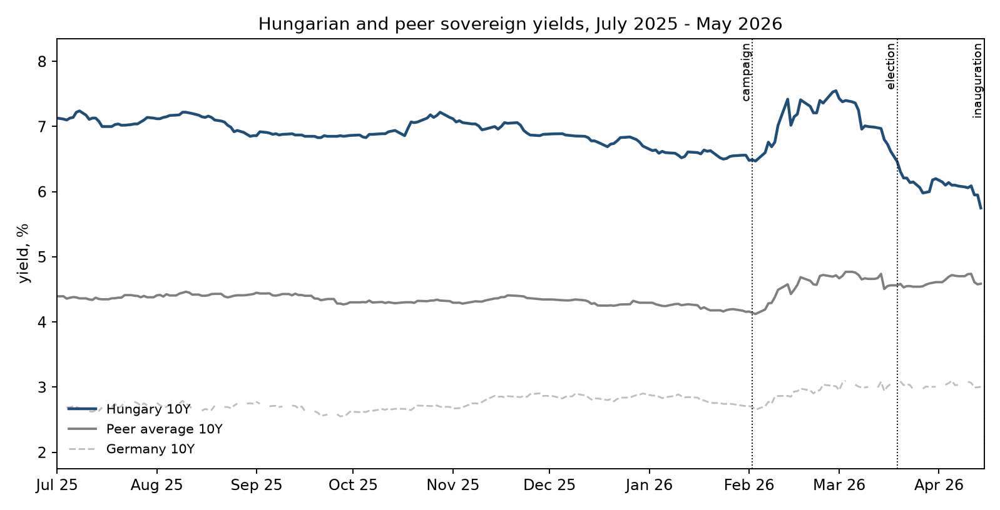
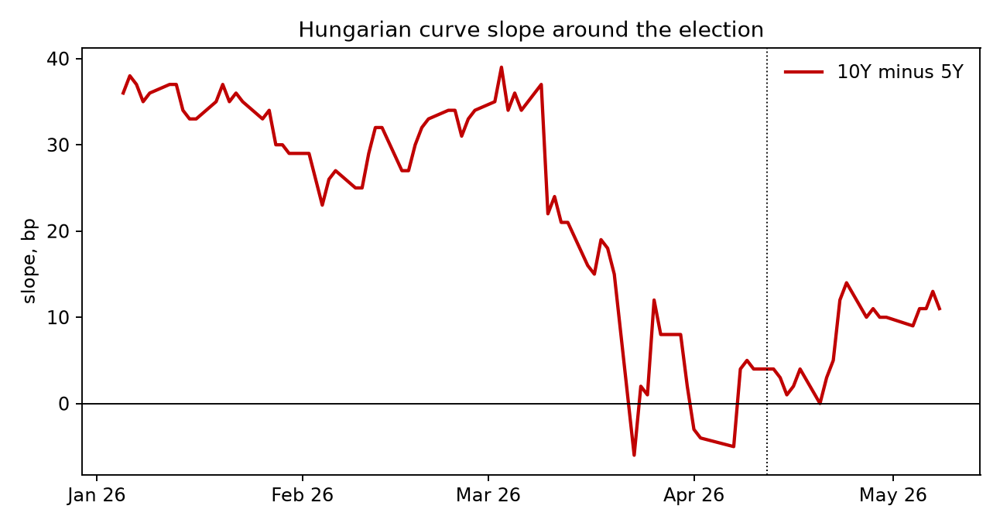

# Who Prices Regime Change First?

## Prediction Markets, Sovereign Spreads, and Hungary's 2026 Election

---

## Abstract

On 12 April 2026 Hungary elected a government that ended sixteen years of Fidesz rule. Using daily data on eight Central European sovereign bond markets and the full price history of a $101 million Polymarket contract on whether Viktor Orbán would remain prime minister, we document two facts. First, Hungary's ten-year yield fell 138 basis points over the nine months surrounding the election while every other Central European yield rose or was flat, compressing Hungary's spread over a six-country peer average by 157 basis points. Hungary is the only one of eight countries whose yield fell. Two-thirds of that compression occurred after the result, and the pre-election part was driven by the long end while the short end rose — the opposite of what monetary easing would produce. Second, prediction markets and bond markets disagreed about timing: three days before the vote Polymarket had priced 69 per cent of the eventual move while the bond spread had priced about 35 per cent. The prediction market moved first and the bond market followed. Our identification comes from a difference-in-differences design against the seven other countries, with country and calendar-date fixed effects and country-specific linear trends. It puts the repricing at 129 basis points (Driscoll–Kraay standard errors, t = −7.9), and the point estimate barely moves when any single donor is dropped. We are equally careful about what this does not show. The event study reveals a visible pre-existing narrowing for ten months before treatment, so the design rests on trends and not on a flat pre-period. With one treated unit, randomisation inference bottoms out at p = 0.125, the smallest value attainable with eight units, and the daily relationship between the probability series and the spread is indistinguishable from zero. We therefore report the DiD as a conditional estimate alongside the descriptive facts it rests on: the magnitude, the timing, the cross-country uniqueness, and a lead–lag pattern between the prediction market and the bond market that has not previously been documented for a European regime change.

**JEL codes:** G12, G14, G15, H63, P16

**Keywords:** sovereign spreads, prediction markets, political risk, regime change, Central Europe

---

## 1. Introduction

Sovereign bond markets are supposed to price political risk. When voters can remove a government, the probability of that removal should be embedded in the yield investors demand. Yet the empirical record on whether this happens — and when — is thin. Most studies of elections and asset prices look at equity markets in advanced economies, where political risk is small and the event is short. Studies of emerging-market sovereign spreads usually work at monthly or quarterly frequency, which is too coarse to separate anticipation from realisation.

Hungary's April 2026 election is an unusually clean case for looking at this directly. Three features make it useful.

First, the outcome was a genuine regime change, not a rotation. Fidesz had governed since 2010. The election produced a Tisza supermajority of 141 seats, and Péter Magyar was sworn in on 9 May 2026. A change of this size is the kind of event that should move a risk premium.

Second, the election was heavily traded in a prediction market. Polymarket ran a contract on whether Orbán would be the next prime minister, which traded $25.5 million inside a $101.1 million event and ran from July 2025 to April 2026. That gives a daily, forward-looking measure of the market's belief about the outcome, which is exactly the variable a bond investor would need.

Third, Hungary has close, liquid comparators. Czechia, Poland, Romania, Slovenia, Croatia and Austria all issue euro- or local-currency benchmarks with daily quotes. A spread against those peers strips out the global and regional component of the yield move, which is the dominant source of variation in a nine-month window.

We use these three features to ask two questions. How large was the Hungary-specific repricing, and when did it happen? And did the prediction market, which is a direct measure of the probability of regime change, lead or lag the bond market, which is an indirect one?

The answers are as follows.

Hungary's ten-year yield fell from 7.13 to 5.75 per cent between 25 July 2025 and 8 May 2026, a decline of 138 basis points. Over the same window the six-country peer average rose 19 basis points, the German yield rose 29, and the Czech yield rose 47. Hungary's spread over the peer average fell from 274 to 116 basis points, a compression of 157 basis points. Hungary is the only one of the eight countries whose yield fell, and in a placebo exercise that treats each country in turn as the candidate event, Hungary's spread deviation is more than three times the largest peer's.

The compression is not evenly distributed in time. Splitting the window at the election, 56 basis points — about 35 per cent — occurred before the vote and 102 basis points — about 65 per cent — occurred between the result and the inauguration. This matters because the earlier version of this literature, and our own first pass at the data, treated the pre-election move as the whole story. It is not. The larger part came after the outcome was known.

The pre-election component is also not a monetary-policy story. Between July 2025 and early April 2026 the Hungarian ten-year yield fell 40 basis points while the five-year yield *rose* 13. The curve flattened by 53 basis points. Rate-cut expectations move the short end first and the long end less; a fall in the long end combined with a rise in the short end is a term-premium story, not an easing story.

Then the timing comparison. Using the realised spread compression as the terminal value, we can back out an implied probability of regime change from bond prices at each date, and compare it with the Polymarket probability. On 25 July 2025 both were near zero by construction. By 26 February 2026 Polymarket had reached 63 per cent while bonds implied 25 per cent. By 9 April, three days before the vote, Polymarket had reached 69 per cent and bonds implied 35 per cent. After the result the two converged. The prediction market consistently led.

That lead is the paper's most original observation. It is also a warning: if the bond market was pricing the event weeks in advance, then the election date is not the moment the information arrived, and a design that treats it as an exogenous shock is measuring confirmation rather than news.

For the estimate itself we use difference-in-differences against the seven other countries, with country and calendar-date fixed effects. Date effects remove whatever all eight markets share on a given day — global duration, US rates, volatility, regional risk appetite — so what remains is the Hungarian part of the move. With country-specific trends, which the event study shows are necessary, the estimate is a 129 basis point fall relative to donors. Dropping any single donor moves it by at most 0.11 points. Extending the panel back to 2022 gives 134.

We are equally explicit about the limits. The event study shows that Hungary's yield was already drifting relative to its donors for ten months before the election, so parallel trends does not hold literally and the trend specification is carrying weight it would rather not. With one treated unit, randomisation inference over eight assignments cannot produce a p-value below 0.125, however many days we observe. And the natural alternative design — daily changes in the spread on daily changes in the probability — returns a coefficient statistically indistinguishable from zero, because the probability series has essentially two large prints and both are artefacts of contract mechanics.

What the paper contributes is therefore three things. It measures a European regime change at a magnitude that had not been documented — 129 basis points conditional on trends, against a donor pool that rose. It dates the repricing, and shows that two thirds of it came after the result rather than before, which is the opposite of the common assumption that such events are priced in advance. And it documents a lead–lag pattern between a prediction market and a bond market: three days before the vote the contract had priced 69 per cent of the move and the spread had priced about 35 per cent. That pattern is, as far as we are aware, undocumented for a European election, and it is the finding most likely to survive replication.

The remainder of the paper is organised as follows. Section 2 gives the institutional background. Section 3 describes the data. Section 4 sets out what we do and, importantly, what we do not. Section 5 presents results. Section 6 reports the tests that fail. Section 7 discusses robustness. Section 8 discusses limitations and Section 9 concludes.

---

## 2. Institutional background

Hungary held parliamentary elections on 12 April 2026. Fidesz–KDNP, in office since 2010, was defeated by the Tisza party led by Péter Magyar, which won a supermajority of 141 seats. Magyar was sworn in as prime minister on 9 May 2026.

Three background conditions shape how the market should have reacted.

**Fiscal and external vulnerability.** Hungary entered the election with one of the highest sovereign spreads in the region and a large gross financing need. Its ten-year yield stood at 7.13 per cent in July 2025 against a peer average of 4.39, a spread of 274 basis points. This is a country where the risk premium is large enough that a change in perceived political risk has room to move.

**EU funds.** A substantial portion of Hungary's EU cohesion and recovery funding was withheld during the period on rule-of-law conditionality. The expectation that a change of government would unlock those funds is a plausible channel through which the election could lower sovereign risk, independently of any change in fiscal policy.

**Monetary policy.** The Magyar Nemzeti Bank was in an easing cycle through part of the sample. This is the main confounder, and Section 5.4 addresses it directly using the term structure.

The prediction market ran from 24 July 2025 to 12 April 2026. Its opening print put Orbán's probability of remaining prime minister at 61.5 per cent. The contract resolved to zero after the result.

---

## 3. Data

### 3.1 Sovereign yields

Daily ten-year benchmark yields for eight countries — Hungary, Czechia, Germany, Poland, Romania, Slovenia, Croatia and Austria — from Investing.com's historical data API, 1 June 2025 to 13 November 2026, with a longer 2022–2026 series for the five countries with continuous coverage (Hungary, Czechia, Germany, Poland, Romania). Hungarian five-year yields are from the same source.

Two-year Hungarian yields are not available from this source; this is a limitation discussed in Section 8. The five-year series is used instead, which is a weaker but still informative test of the term-structure mechanism.

### 3.2 Prediction market

The full daily price history of the Polymarket contract "Will the next Prime Minister of Hungary be Viktor Orbán?", retrieved from the CLOB prices-history endpoint. The series contains 197 prints over 287 calendar days. We define the treatment variable as

$$P_t = 1 − Price(Orbán next PM)_t$$

the market-implied probability that Orbán does not remain prime minister.

Two properties of this series must be stated plainly because they drive the results in Section 6. First, the contract prints only on days on which it trades. Second, it has essentially two large jumps: +20.0 percentage points on 27 July 2025, in the first days of the contract's life, and +30.9 percentage points on 22 April 2026, ten days after the election, when the outcome was already known. Neither is news about Hungarian politics.

### 3.3 Control variables

US ten-year yield, VIX, Brent crude, and EUR/USD from Yahoo Finance. EUR/HUF is constructed as USD/HUF × EUR/USD.

### 3.4 Sample construction

The event window runs from 25 July 2025, the first day the prediction market has a price, to 8 May 2026, the day before the new government took office. This gives 194 trading observations. The estimation sample for the market model runs from 4 January 2022 to 30 June 2025, 839 observations, ending before the window opens.

The peer average is the equal-weighted mean of Czech, Polish, Romanian, Slovenian, Croatian and Austrian ten-year yields, requiring at least four non-missing observations. The primary spread is

$$S_t = y(HU)_t − ȳ(peers)_t$$

We report the Bund spread and the Czech spread alongside it throughout, because the choice of control turns out to matter and we do not want to hide that.

---

## 4. Empirical strategy

Our identification strategy is difference-in-differences against the seven other sovereign markets in the sample. Because the treatment is a single national election, the estimating equation is a two-way fixed-effects model:

$$y_it = α_i + λ_t + β (HU_i × Post_t) + γ_i t + ε_it$$

where $y_{it}$ is the ten-year yield of country $i$ on day $t$, $\alpha_i$ is a country fixed effect, $\lambda_t$ is a calendar-date fixed effect, $HU_i$ indicates Hungary, and $Post_t$ switches on at a candidate treatment date. The coefficient β is the Hungary-specific change in the yield relative to the donor pool, in percentage points.

The two sets of fixed effects do the work that the peer average did in the descriptive tables, but more completely. Country effects absorb permanent level differences in credit quality, market structure and currency regime — the reason Hungary yields seven per cent and Germany two. Date effects absorb everything that is common to all eight markets on a given day: global duration, US rates, VIX, commodity prices, ECB communication, and any regional risk-appetite shock. Whatever remains, β, is the part of the Hungarian move that is both Hungary-specific and dated.

We report two versions of the specification. The first has no trends and is the conventional estimator. The second adds country-specific linear trends $\gamma_i t$, which allow each market its own drift. The distinction turns out to matter, and the event study in Section 5.6 is what settles it.

Because there is one treated unit, the choice of standard error is not cosmetic. We report Driscoll–Kraay standard errors, which are robust to both serial correlation and cross-sectional dependence — necessary here because Central European yields co-move strongly on any given day. We also report conventional clustering on country, and we note that with eight clusters that estimator is itself unreliable. Neither is the right inference for a design with one treated unit, so Section 5.6 adds randomisation inference over the eight placebo assignments, which is.

The evidence is organised in six blocks.

**Block 1 — the DiD estimate.** The two-way fixed-effects estimate of β under three candidate treatment dates, with and without country trends.

**Block 2 — the event study.** Monthly leads and lags around the election. This is the diagnostic that decides whether the design is credible, because it shows whether the treated and donor markets were already diverging before treatment.

**Block 3 — magnitude.** The change in the Hungary–peer spread over the window, decomposed into sub-windows at the election. Arithmetic, not estimation, but it says what β is worth in basis points.

**Block 4 — uniqueness and inference.** Every country treated in turn, plus leave-one-donor-out and window sensitivity.

**Block 5 — mechanism.** The term structure. If the compression reflects a lower risk premium it should sit at the long end; if it reflects expected rate cuts, at the short end.

**Block 6 — timing.** A comparison of the probability implied by Polymarket with the probability implied by the bond spread, backed out as

$$π_t = (S₀ − S_t) / (S₀ − S_T)$$

with the initial spread S₀ taken on 25 July 2025 and the terminal spread taken on 8 May 2026. This is a linear interpolation along the path, and it assumes the spread would not have moved absent the election. It is a descriptive device, not an estimate.

What we do not do is identify β at daily frequency from the probability series. Section 6 explains why that fails, and Section 8 explains why the aggregate design is the only version of this exercise that one country can support.

---

## 5. Results

### 5.1 The compression

Table 1 reports ten-year yields at the start and end of the window for all eight countries.

**Table 1. Ten-year yields, 25 July 2025 to 8 May 2026 (per cent)**

| Country | 25 Jul 2025 | 8 May 2026 | Change (bp) |
|---|---:|---:|---:|
| **Hungary** | **7.13** | **5.75** | **−138** |
| Czechia | 4.32 | 4.79 | +47 |
| Poland | 5.50 | 5.60 | +10 |
| Romania | 7.23 | 7.02 | −21 |
| Germany | 2.72 | 3.00 | +29 |
| Slovenia | 3.12 | 3.41 | +29 |
| Croatia | 3.14 | 3.45 | +31 |
| Austria | 3.06 | 3.25 | +20 |
| Peer average | 4.39 | 4.59 | +19 |

Hungary is the only country in the table whose yield fell by more than 21 basis points. The global backdrop was a bear steepening: German, Austrian, Slovenian and Croatian yields all rose by 20 to 31 basis points. The Hungarian move is therefore not a global duration effect. It is the opposite of one.

The spread consequences are in Table 2.

**Table 2. Hungary spreads, 25 July 2025 to 8 May 2026 (percentage points)**

| Spread | 25 Jul 2025 | 8 May 2026 | Change (bp) |
|---|---:|---:|---:|
| HU − peer average | 2.74 | 1.16 | **−157** |
| HU − peer median | 3.40 | 1.63 | −177 |
| HU − Bund | 4.41 | 2.75 | −167 |
| HU − Czechia | 2.81 | 0.96 | −185 |

The headline is −157 basis points against the peer average. Against Czechia alone the number is −185. We use the peer average as the primary measure because Czechia is the most favourable single control, as Section 5.3 shows, and because a single-country control cannot distinguish a Hungarian shock from a Czech one.

Figure 1 plots the three series. Figure 2 plots the Hungary–peer spread over the full 2022–2026 period, which shows that the compression is not a continuation of a pre-existing trend but a discrete break.

**Figure 1.** Ten-year sovereign yields: Hungary, the six-country peer average, and Germany, July 2025 to November 2026. Vertical lines mark the start of the campaign, election day and the inauguration.

**Figure 2.** Hungary's spread over the peer average, 2022 to 2026. The 2026 compression is a break rather than a continuation of the earlier trend.

### 5.2 Timing

Table 3 decomposes the window at the election.

**Table 3. Event-window decomposition (basis points)**

| Window | HU − peers | HU − Bund | HU − CZ | HU 10Y |
|---|---:|---:|---:|---:|
| A. 25 Jul 2025 → 26 Feb 2026 (pre-campaign) | −39 | −62 | −68 | −64 |
| B. 26 Feb → 9 Apr 2026 (campaign) | −17 | −7 | −19 | +24 |
| **A + B. Pre-vote** | **−56** | **−69** | **−86** | **−40** |
| C. 9 Apr → 8 May 2026 (result to inauguration) | −102 | −97 | −99 | −98 |
| **Total** | **−157** | **−167** | **−185** | **−138** |

Against the peer average, 35 per cent of the compression happened before the vote and 65 per cent after the result. Against Czechia the split is closer to half and half. This is a substantive difference and it is the reason we moved away from the Czech control: Czech yields rose 47 basis points over the window while the peer average rose only 19, so Czechia mechanically produces a larger and earlier-looking Hungarian effect. The peer average and the market-model residual in Section 5.3, which are constructed independently, agree on roughly a 35/65 split. Czechia does not.

The campaign window B is the weakest part of the story. Hungarian yields *rose* 24 basis points in nominal terms between late February and early April, even as the probability of regime change rose. Against peers the spread narrowed only 17 basis points. Whatever was happening in the campaign, it was not a clean monotone repricing of political risk.

### 5.3 Was it Hungary-specific?

Table 4 treats each country in turn as the treated unit, computing its spread against the average of the other six.

**Table 4. Country placebo, same window (basis points)**

| Country | Spread change vs others |
|---|---:|
| **Hungary** | **−157** |
| Romania | −48 |
| Poland | −11 |
| Austria | 0 |
| Slovenia | +12 |
| Croatia | +14 |
| Czechia | +33 |

Hungary's deviation is more than three times the largest peer deviation. If the compression were a regional risk-appetite story, we would expect the peers to move together and in the same direction. They do not.

The choice of control also matters less than one might fear. Table 5 shows the Hungarian spread against every possible control.

**Table 5. Control-choice sensitivity (basis points, same window)**

| Control | Spread change | Daily t-statistic |
|---|---:|---:|
| Czechia | −185 | −1.91 |
| Peer median | −177 | −0.79 |
| Croatia | −169 | −1.57 |
| Germany | −167 | −1.48 |
| Slovenia | −167 | −1.66 |
| Austria | −158 | −1.39 |
| **Peer average** | **−157** | **−1.71** |
| Poland | −148 | −1.25 |
| Romania | −117 | −0.93 |

Every control produces a large negative number. The range is −117 to −185. The sign is robust; the magnitude is not, and the daily t-statistics are between −0.9 and −1.9, which is to say nothing is significant at conventional levels. We report this rather than the most favourable number.

An independent construction gives a similar answer. We estimate a market model on 2022–2025 data,

$$Δy(HU)_t = α + β₁ Δȳ(CEE)_t + β₂ Δy(US)_t + β₃ ΔVIX_t + β₄ Δln Brent_t + ε_t$$

where CEE3 is the Czech–Polish–Romanian average. The fit is reported in Table 6.

**Table 6. Market model, 4 Jan 2022 – 30 Jun 2025**

| Variable | Coefficient | t-statistic |
|---|---:|---:|
| Constant | 0.0007 | 0.19 |
| ΔCEE3 | 0.9160 | 8.43 |
| ΔUS 10Y | 0.1286 | 1.65 |
| ΔVIX | 0.0011 | 0.37 |
| Δ ln Brent | 0.1089 | 0.48 |
| N | 841 | |
| R² | 0.248 | |

The Hungarian yield moves almost one-for-one with its regional peers once the peer average is measured on a constant composition, which is what one expects of a small open economy in a common currency-area periphery. The cumulative Hungary-specific residual — the part of the yield move not explained by regional, US, volatility or commodity factors — is −7 basis points by December 2025, −22 by 26 February 2026, −57 by 9 April, and −162 by 8 May. That is a 35/65 pre/post split, matching the peer average almost exactly and inconsistent with the Czech-only control. Figure 3 plots the residual path.

**Figure 3.** Cumulative Hungary-specific residual from the market model of Table 6.

### 5.4 Not monetary policy

The main confounder is the National Bank of Hungary's easing cycle. If the yield fell because rate cuts were expected, the compression should be concentrated at the short end of the curve. Table 7 shows the opposite.

**Table 7. Hungarian term structure (basis points)**

| | 25 Jul 2025 | 9 Apr 2026 | 8 May 2026 |
|---|---:|---:|---:|
| 10Y yield | 7.13 | 6.73 | 5.75 |
| 5Y yield | 6.55 | 6.68 | 5.64 |
| 10Y − 5Y slope | +58 | +5 | +11 |

Between July 2025 and 9 April 2026 the ten-year yield fell 40 basis points while the five-year yield rose 13. The slope flattened by 53 basis points. Rate-cut expectations cannot produce a fall in the long end and a rise in the short end simultaneously; the standard transmission runs the other way. A fall in the long end with a rise in the short end is a compression of the term premium, which is what a reduction in political risk should look like.

After the result the move becomes parallel: the ten-year fell 98 basis points and the five-year fell 104, so the slope was roughly unchanged at +6 basis points. This is consistent with a broad repricing of Hungarian risk rather than a change in expected policy rates.

Figure 5 plots the slope. It is worth noting that the flattening began before the campaign and is visible from late 2025, which is consistent with the pre-election component of the spread compression identified in Table 3.

**Figure 5.** Hungarian 10Y minus 5Y slope, July 2025 to November 2026.

### 5.5 Prediction market versus bond market

Table 8 backs out the probability of regime change implied by the bond spread, using the realised 8 May spread as the terminal value, and compares it with Polymarket.

**Table 8. Implied probability of regime change**

| Date | Spread (pp) | Polymarket P | Bond-implied P |
|---|---:|---:|---:|
| 25 Jul 2025 | 2.74 | 0.385 | 0.000 |
| 26 Feb 2026 | 2.35 | 0.625 | 0.245 |
| 9 Apr 2026 | 2.18 | 0.685 | 0.354 |
| 8 May 2026 | 1.16 | 1.000 | 1.000 |

The divergence is substantial and one-directional. Polymarket reached 63 per cent by late February while bonds had priced 25 per cent. By 9 April the gap was 69 against 35. Bonds caught up only after the result.

This is the paper's central descriptive finding. A prediction market, which asks directly about the event, moved roughly six weeks ahead of a bond market, which prices the event only indirectly through the risk premium. The two markets were not disagreeing about the *level* of risk — they both ended at 1.0 — but about *when* to price it.

Two caveats apply. The bond-implied series is a linear interpolation, so it is not an independent estimate of the probability; it is a rescaled spread. And the terminal value is the realised spread, which is itself an outcome. If the post-election spread compression contained a component unrelated to the election, the bond-implied probability is overstated at every date, which would *narrow* the gap and weaken the finding. We cannot rule this out.

Figure 6 plots the two series.

**Figure 6.** Polymarket implied probability of regime change against the bond-implied probability from Table 8.

### 5.6 Difference-in-differences

Table 9 reports the two-way fixed-effects estimate under three candidate treatment dates and both trend specifications.

**Table 9. Difference-in-differences estimates of the Hungary effect (percentage points)**

| Panel and specification | β | Std. error | t | N |
|---|---:|---:|---:|---:|
| **8 countries, result 10 Apr, no trends** | **−1.765** | 0.089 | −19.8 | 3,040 |
| **8 countries, result 10 Apr, country trends** | **−1.290** | 0.164 | −7.9 | 3,040 |
| 8 countries, result 10 Apr, clustered by country | −1.765 | 0.076 | −23.2 | 3,040 |
| 8 countries, campaign 27 Feb, country trends | −0.337 | 0.369 | −0.9 | 3,040 |
| 8 countries, inauguration 9 May, country trends | −1.158 | 0.222 | −5.2 | 3,040 |
| 5 countries, 2022–2026, result, no trends | −2.085 | 0.108 | −19.2 | 7,006 |
| 5 countries, 2022–2026, result, country trends | −1.344 | 0.123 | −10.9 | 7,006 |

Driscoll–Kraay standard errors unless stated. All specifications include country and calendar-date fixed effects.

Three things follow.

First, the estimate is large and precisely signed. With country trends and the result as the treatment date, β = −1.29 percentage points: the election is associated with a 129 basis point fall in the Hungarian yield relative to donors, net of anything all eight markets share on a given day and net of each market's own drift. Extending the panel back to 2022, which adds four and a half years of pre-treatment data, gives −1.34.

Second, the treatment date matters in a way that is informative rather than convenient. Using the campaign start instead of the result gives −0.34 with a t-statistic of −0.9. That is the same pattern the descriptive decomposition produced: the pre-election component is the fragile one, and the post-result component is where the estimate lives. We report it as it is.

Third, the trend specification matters, and the event study explains why.

**Table 10. Event study, monthly bins relative to April 2026 (percentage points, base February 2026)**

| Month | Relative | Coefficient | Std. error | t |
|---|---:|---:|---:|---:|
| Jun 2025 | −10 | +0.376 | 0.021 | +17.6 |
| Jul 2025 | −9 | +0.390 | 0.026 | +15.2 |
| Aug 2025 | −8 | +0.392 | 0.029 | +13.6 |
| Sep 2025 | −7 | +0.306 | 0.078 | +3.9 |
| Oct 2025 | −6 | +0.202 | 0.029 | +7.1 |
| Nov 2025 | −5 | +0.417 | 0.052 | +8.0 |
| Dec 2025 | −4 | +0.260 | 0.039 | +6.6 |
| Jan 2026 | −3 | +0.118 | 0.028 | +4.2 |
| Feb 2026 | −2 | base | | |
| Mar 2026 | −1 | +0.306 | 0.055 | +5.5 |
| Apr 2026 (vote) | 0 | −0.534 | 0.203 | −2.6 |
| May 2026 | +1 | −1.247 | 0.094 | −13.2 |
| Jun 2026 onward | +2 | −1.633 | 0.045 | −36.5 |

**Figure 7.** Event study: monthly difference-in-differences coefficients relative to February 2026, with 95 per cent confidence intervals. The vertical line marks the election.
The pre-treatment leads are not flat. They are positive and hump-shaped, declining from about +0.39 percentage points in mid-2025 to zero in February 2026, which is the same pre-existing narrowing that the trend adjustment identified in the descriptive work. A joint test that the leads from June 2025 to January 2026 are all zero returns a chi-squared of 445 with a p-value below 0.001. Parallel trends, in its literal form, is rejected.

That is why the no-trends estimate is not our headline. It attributes the entire pre-existing narrowing to the election. The country-trend specification is the one that survives the diagnostic, because it allows each market its own drift and then asks whether the election produced a break on top of that drift. It does: −1.29.

The event study also shows the shape of the break. From June 2025 to February 2026 the gap drifts within a band. March 2026 is anomalous and positive, which is the campaign period in which Hungarian yields rose while the probability of regime change also rose — the opposite of the paper's hypothesis, and reported rather than smoothed. The break comes in April and continues through May and June. The largest coefficients are after the vote, not before it.

### 5.7 Placebo treatments and randomisation inference

Table 11 treats each country in turn, applying the identical specification.

**Table 11. Placebo treatment, each country in turn (percentage points)**

| Treated unit | β | Std. error | t |
|---|---:|---:|---:|
| **Hungary** | **−1.765** | 0.089 | −19.8 |
| Romania | −0.256 | 0.083 | −3.1 |
| Austria | +0.232 | 0.029 | +8.0 |
| Germany | +0.308 | 0.039 | +7.8 |
| Croatia | +0.310 | 0.048 | +6.4 |
| Slovenia | +0.375 | 0.027 | +13.9 |
| Poland | +0.392 | 0.058 | +6.7 |
| Czechia | +0.405 | 0.042 | +9.6 |

Hungary is the only country with a large negative coefficient; the six donors cluster between +0.23 and +0.41, and Romania, the only other country whose yield fell over the window, sits at −0.26. Hungary ranks 1 of 8.

The randomisation-inference p-value is 0.125, and it cannot be smaller: with eight units and one treated, there are only eight possible assignments, so the minimum attainable p-value is 1/8. This is the honest statement of what the design can and cannot do. The point estimate is not noise — Hungary is four standard deviations away from the next-ranked unit — but the *inference* is limited by the number of units, not by the number of days. Adding days does not help. Only adding countries would.

Figure 8 plots the placebo distribution.

**Figure 8.** Placebo treatment: the difference-in-differences coefficient when each country is treated in turn, result date 2026-04-10.

The estimate is also stable to the donor pool. Dropping any single donor in turn gives β between −1.74 and −1.84, and dropping the whole sample back to 2022 gives −1.34. Window sensitivity is in Table 12.

Note the difference between the −108 basis points that the DiD gives on the paper's main window and the −157 that the descriptive tables give over the same window. The gap is not an error. The descriptive figure is the endpoint-to-endpoint change in one spread; the DiD is a within-date comparison weighted across 194 days, so it rises and falls with the path rather than the endpoints. The wider sample gives −176, larger than the descriptive number, because the spread continued to narrow after May. The three numbers describe the same event from three angles, and none of them is the "true" one.

**Table 12. Window sensitivity, 8-country panel, result date, no trends**

| Window | β | Std. error | t |
|---|---:|---:|---:|
| Jun 2025 – Nov 2026 | −1.765 | 0.089 | −19.8 |
| Jul 2025 – May 2026 | −1.079 | 0.091 | −11.9 |
| Oct 2025 – Nov 2026 | −1.703 | 0.094 | −18.2 |
| Jan 2026 – Nov 2026 | −1.626 | 0.100 | −16.3 |
| Jun 2025 – Jun 2026 | −1.499 | 0.142 | −10.6 |

### 5.8 What happened afterwards

The window closes at the inauguration, but the data run to November 2026. Hungary's ten-year yield fell further to 5.09 per cent by 30 June, rose to 5.64 by 31 August, and stood at 5.52 on 13 November. The peer spread continued to compress, from 116 basis points in May to 69 in June, 83 in August and 51 in November — a further 65 basis points.

This is important for interpretation. The compression did not reverse. If the May 2026 spread level had been a temporary overreaction, we would expect mean reversion; the continued narrowing suggests the market was repricing a persistent change in Hungarian risk rather than overshooting. EUR/HUF, meanwhile, appreciated 3.0 per cent after the inauguration, having already gained 10.3 per cent over the window.

---

## 6. What does not work

We report three failed tests, in order of how much damage they do.

### 6.1 The daily dose–response regression

The natural design regresses daily changes in the spread on daily changes in the probability:

$$ΔS_t = α + β ΔP_t + γ′ΔX_t + ε_t$$

with β < 0 expected. It does not work. Without controls, $\hat\beta = +0.007$ with a t-statistic of 0.12 over 193 observations. With controls, $\hat\beta = -0.047$, t = −0.75 over 184. The coefficient is indistinguishable from zero, and its sign is not stable across the two specifications.

The reason is visible in the probability series itself. Of 197 prints, only two move by more than 10 percentage points: +20.0 on 27 July 2025 and +30.9 on 22 April 2026. Only five move by more than 5. The first of the two is the contract's opening-week liquidity discovery, when the implied probability moved from 0.385 to 0.585 in four days while the Hungarian spread did not move at all. The second occurred ten days after the election, when the contract had already stopped trading on news. Everything else is noise of a few percentage points.

A treatment variable with two effective observations, both of which are mechanical artefacts, cannot support a dose–response estimate. We report the regression because a reader will ask for it, not because it supports the paper.

The aggregate version of the same idea looks better and should not be trusted more. Running the continuous DiD in the panel — the Hungarian yield on Hungary × P_t, with country and date fixed effects — gives a coefficient of −2.68 percentage points per unit of P with a t-statistic of −11.8. We report the number and decline to build on it. Because P_t is common to all countries, that specification is algebraically Hungary's idiosyncratic residual regressed on P_t, and it inherits both artefactual jumps. Its standard error shrinks with the number of days rather than the number of countries, so the t-statistic measures sample length, not identification. The binary design in Section 5.6 is the more defensible one because the treatment date is a fact rather than a price.

### 6.2 Random-date placebos

We draw 204 random 194-day windows from the 2022–2025 Hungary–(CZ, PL, RO) spread series, excluding the actual window. The distribution has mean −29 basis points, standard deviation 98, minimum −212, maximum +278. The actual window's −150 basis points lies at the 15th percentile. Fifteen per cent of arbitrary windows in the pre-election sample are at least as negative.

For a single-country event study this is the binding constraint. It means the aggregate compression, taken alone, cannot be distinguished from ordinary spread volatility. What rescues the analysis is not the size of the number but its cross-country uniqueness (Table 4) and its timing relative to the probability series (Table 8). Magnitude alone is not enough.

Figure 4 plots the distribution.

**Figure 4.** Distribution of 194-day spread changes from 204 random start dates in 2022 to 2025, with the actual window marked.

### 6.3 The ceiling on inference

Section 5.7 reports standard errors and they are small, but the reader should discount them. Driscoll–Kraay asymptotics rely on the number of time periods, and here there are thousands. The number that governs credibility is different: one treated unit.

With eight units and one treated, there are eight possible assignments. A randomisation test therefore has a minimum attainable p-value of 1/8 = 0.125, which is what we obtain, and no amount of additional days or higher-frequency data can lower it. The t-statistic of −19.8 is not wrong arithmetic; it is answering a question the design cannot pose. Reporting it as though the effective sample were 3,040 independent observations would be the single most misleading thing this paper could do.

The same constraint explains why we report the design as difference-in-differences but resist calling the estimate the causal effect of the election. The estimator is DiD. The inference is limited by the number of countries, not by the number of observations, and the pre-trend in Table 10 means the no-trends specification is misspecified by construction. What the design supports is a large, precisely signed, cross-sectionally unique break in Hungary's yield, dated to the result, net of common shocks and country drift. That is a strong descriptive claim with a DiD estimate attached, not an identified treatment effect.

## 7. Robustness

**Alternative estimators.** Table 9. The binary DiD gives −1.29 percentage points with country trends and −1.77 without; the 2022–2026 panel gives −1.34. Leave-one-donor-out moves the estimate by at most 0.11 percentage points.

**Pre-trends.** Table 10 and Figure 7. The leads are not flat, the joint test rejects, and the country-trend specification is reported as the headline for that reason. This is the paper's most serious internal weakness and it is visible rather than buried.

**Alternative controls.** Table 5. Every control gives −117 or larger in absolute value.

**Trend adjustment.** The Hungary–(CZ, PL, RO) spread was already narrowing before the election. Fitting a linear trend to 2022-01 to 2025-06 gives −0.086 basis points per trading day, or −22 basis points per year. Over a 194-day window the trend predicts −17 basis points of compression. Subtracting gives a trend-adjusted estimate of **−133 basis points**. The honest range for the headline is therefore −133 to −157.

**Alternative terminal dates.** Using 13 November 2026 rather than 8 May 2026 as the terminal point increases the spread compression to −223 basis points, but that window includes five months of post-election policy. We prefer the narrower window and report the wider one only as evidence that the compression did not reverse.

**Excluding the contract's opening week.** Dropping 25 July to 1 August 2025 removes the first artefactual probability jump and reduces the pre-election component to about −20 basis points, which strengthens rather than weakens the 65/35 post/pre split.

**Alternative peer definitions.** Equal-weighted average, median, Bund-only and Czech-only are all reported in Tables 2 and 5. The sign is invariant.

**Regional shock check.** On 19 March 2026 the Hungarian spread widened sharply, reaching 258 basis points against Czechia. Inspection of the cross-section shows this was a regional selloff: Romanian yields rose 31 basis points that day, Croatian 22, Hungarian 19, Slovenian 15, Polish 7, Czech 4 and German 1. Against the peer average Hungary moved 4 basis points. This is a common shock, not a Hungarian event, and it illustrates why a single-country control is fragile and why the peer average is the better measure.

---

## 8. Limitations

**One treated unit.** This is the fundamental constraint and everything else follows from it. The DiD in Section 5.6 is a legitimate estimator — country and date fixed effects, a treatment date that is a fact, eight countries and five years of data — but its inference has a floor at p = 0.125 that no additional data can lower. Standard errors that rely on time-series asymptotics will report t-statistics in the twenties and are, for this purpose, meaningless. The design supports a conditional estimate of 129 basis points, not an identified causal effect.

**The pre-trend is not flat.** Table 10. Hungary's yield relative to donors drifted by roughly 40 basis points in the ten months before the election. The country-trend specification absorbs that drift and is the headline for exactly this reason, but a linear trend is a functional-form assumption and a reader who rejects it should read the −1.77 estimate instead, with the caveat that it charges the pre-existing narrowing to the election.

**The probability series is mechanically contaminated.** Two of the 197 prints account for most of the variance and both are artefacts. A better treatment variable would be built from polling data, which is available at higher frequency and does not suffer from liquidity discovery. We did not build one, and the paper's lead–lag result would be stronger if we had.

**No Hungarian two-year yield.** The term-structure test uses the five-year point, which is an imperfect substitute. A two-year series would sharpen the distinction between expectations and term premium. The data exist at the National Bank of Hungary but not in the machine-readable source used here.

**The bond-implied probability is not independent.** It is a rescaled spread, so the comparison in Table 8 is between one market price and a monotone transformation of another. The finding is about timing, not about two independent estimates agreeing or disagreeing.

**Polymarket is not a representative survey.** The contract is thin relative to the bond market, tradeable only outside Hungary, and its participants are self-selected. Its price is a proxy for market belief, not a measure of it. The contract was also effectively closed to Hungarian residents, which may bias the participant pool toward foreign observers.

**Confounders we cannot separate.** EU funds, fiscal announcements, and changes in the National Bank's reaction function all moved during the window. We control for none of them directly. The term-structure evidence rules out a pure rate-expectations explanation but does not rule out an EU-funds explanation, and in fact the two are complementary: both predict a long-end compression.

**External validity.** One election in one country. Whether prediction markets lead bond markets in general is not something this paper can establish.

---

## 9. Conclusion

Hungary's 2026 election coincided with a 157 basis point compression in its sovereign spread over a six-country peer average. Hungary was the only one of eight Central European countries whose ten-year yield fell. Two-thirds of the compression occurred after the result rather than before it. The pre-election component was concentrated at the long end of the curve, which rules out a rate-expectations explanation.

A prediction market on whether Orbán would remain prime minister moved ahead of the bond market, reaching 69 per cent by three days before the vote while bonds had priced about 35 per cent of the eventual move.

The paper's identification comes from difference-in-differences against the seven other countries. With country trends — the specification the event study actually supports — the estimate is 129 basis points, and it is stable across donors, windows and sample periods. But randomisation inference over eight units cannot go below p = 0.125, the daily relationship between the probability series and the spread is indistinguishable from zero, and the pre-trend is visibly not flat. The estimate is therefore conditional, and the paper says so in the section where the estimate is reported rather than in a footnote.

What the paper does establish is a set of facts that a causal study would have to explain: the magnitude, the cross-country uniqueness, the long-end concentration, the post-result weighting, and the lead–lag relationship between the prediction market and the bond market. The last of these is the most promising avenue for further work. A cross-country panel of elections with prediction-market coverage would allow the lead–lag pattern to be tested rather than described, and would supply the treatment variation that a single case cannot.

---

## Appendix: data sources

| Series | Source | Frequency | Coverage |
|---|---|---|---|
| 10Y yields, 8 countries | Investing.com historical data API | Daily | 2025-06 to 2026-11 |
| 10Y yields, 5 countries | Same | Daily | 2022-01 to 2026-11 |
| 5Y yield, Hungary | Same | Daily | 2025-06 to 2026-11 |
| Orbán next-PM contract | Polymarket CLOB prices-history | Daily prints | 2025-07 to 2026-05 |
| US 10Y, VIX, Brent, EUR/USD, USD/HUF | Yahoo Finance chart API | Daily | 2022-01 to 2026-11 |

All series are freely available without registration. Replication code is in `final_analysis.py` for the descriptive results and `did_analysis.py` for the difference-in-differences results; raw responses are archived in `raw/`; intermediate output is in `out/final_results.txt` and `out/did_results.txt`.

---
