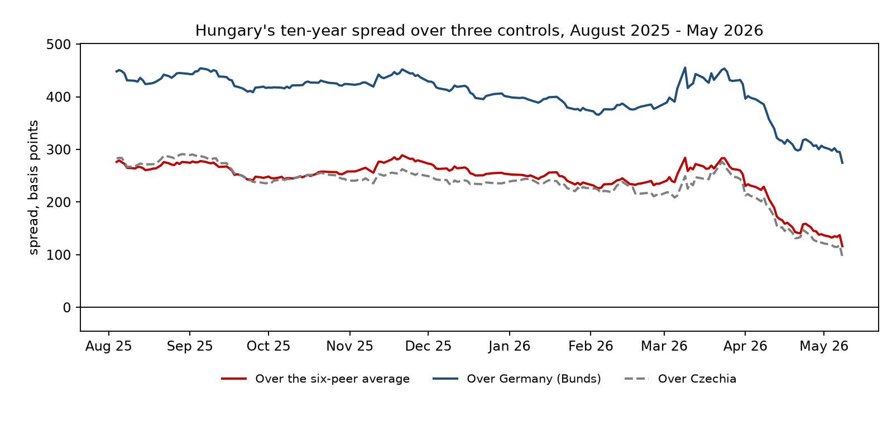
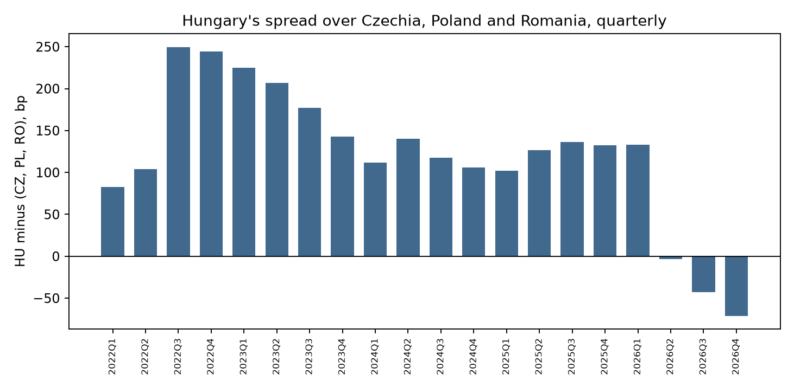
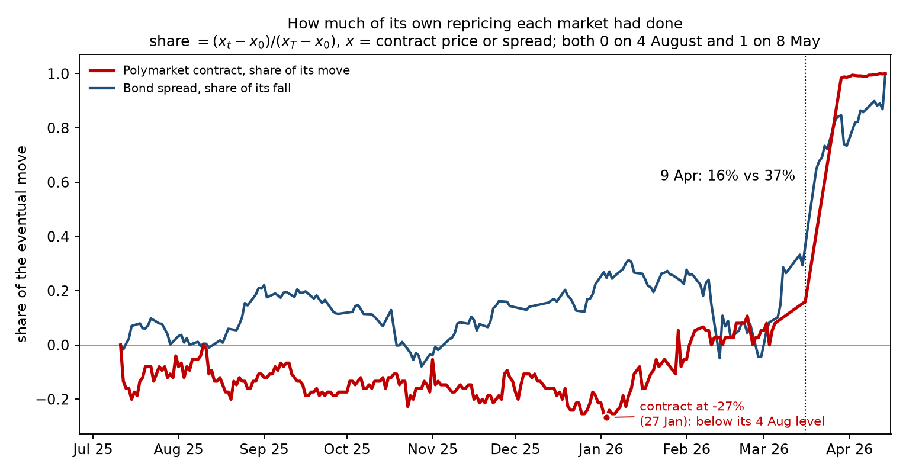
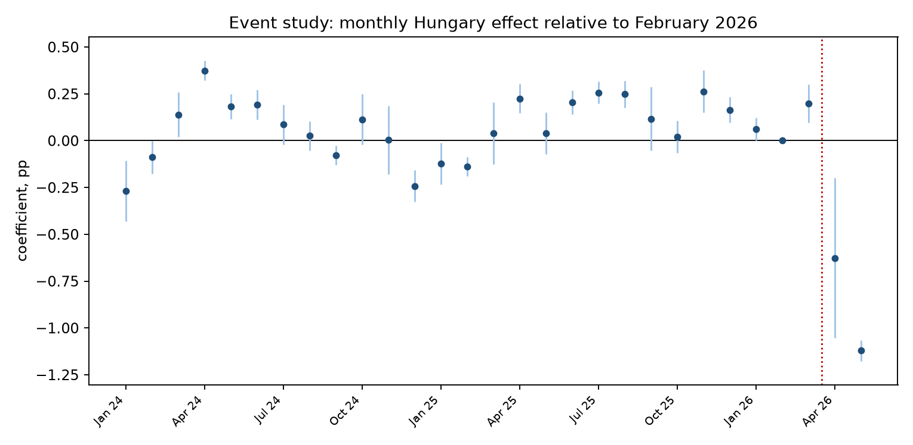

# Who Prices Regime Change First?

## Prediction Markets, Sovereign Spreads, and Hungary's 2026 Election

---

## Abstract

On 12 April 2026 Hungary elected a government that ended sixteen years of Fidesz rule. Using daily data on eight Central European sovereign bond markets and the price history of a Polymarket contract on whether Viktor Orbán would remain prime minister, we ask how much of Hungary's sovereign risk premium repriced around the election and when relative to the vote. Hungary's ten-year yield fell 136 basis points over the nine months surrounding the election while every other Central European yield rose except Romania's, which fell 26, compressing the spread over a six-country peer average by 160 basis points. Nearly two thirds of the compression occurred after the result, and the pre-election part sat at the long end while the short end barely moved, which rules out a rate-expectations explanation. On a scale that measures how much of its own eventual move each market had completed, the spread was ahead of the contract at every date recorded before the vote: 37 per cent against 16 three days out. That ordering reverses if the comparison is anchored on the contract's opening week, so the two series establish that they moved at different times rather than which one moved first. A difference-in-differences design against four neighbouring markets on a 2024–2026 panel, with country and calendar-date fixed effects and a country trend fitted before the treatment date, puts the repricing at 109 basis points (Driscoll–Kraay t = −11.3), and the three trend treatments span five basis points on that sample. The estimate is conditional: with one treated unit, randomisation inference bottoms out at p = 0.125.

**JEL codes:** G12, G14, G15, H63, P16

**Keywords:** sovereign spreads, prediction markets, political risk, regime change, Central Europe

---

## 1. Introduction

Sovereign bond markets are supposed to price political risk. When voters can remove a government, the probability of that removal should be embedded in the yield investors demand. The empirical record on whether this happens, and when, is thin and split three ways.

The first strand asks whether elections move sovereign spreads and reaches no consensus. Block and Vaaler (2004) find that developing-country spreads are highest at the start of the pre-election period and decline as the vote approaches, and that rating agencies downgrade more often in election years. Balding (2011), using daily credit default swap data for thirteen emerging markets, finds the opposite sign: investors price additional risk for elections regardless of party, incumbency or winning margin. Eichler (2014), across twenty-seven emerging markets from 1996 to 2009, finds that elections play no significant role once governance quality and regime type are controlled for, while Brooks, Cunha and Mosley (2022) find no systematic ideological reaction but a volatility effect around government formation. The disagreement is not about data quality. Whether a spread rises or falls around an election depends on what the market expected beforehand, and none of these designs observes that expectation directly.

The second strand supplies the missing object. Wolfers and Zitzewitz (2004) conclude that prediction-market prices are typically accurate forecasts and outperform most moderately sophisticated benchmarks. If a contract price is a usable estimate of the market's subjective probability, it measures directly the expectation the sovereign-spread literature has to infer from the spread itself.

The third gap is methodological. Studies of elections and asset prices use event windows measured in days; studies of sovereign spreads use monthly or quarterly panels. The first cannot see a slow repricing, the second cannot separate anticipation from realisation, and neither was designed to ask when the market moved rather than whether it moved.

This paper joins the three strands by putting a prediction market and a sovereign spread on the same daily axis around a European regime change. The question is: **how much of Hungary's sovereign risk premium repriced around the April 2026 election, and when — before or after the result — relative to what a prediction market on the same event was saying?** The magnitude is answered with a difference-in-differences design against neighbouring sovereign markets, the timing with an event study and a decomposition of the window, and the lead–lag question by comparing the contract price with the probability the spread itself implies.

Hungary's April 2026 election is an unusually clean case. The outcome was a genuine regime change rather than a rotation: Fidesz had governed since 2010, the election produced a Tisza supermajority of 141 seats, and Péter Magyar was sworn in on 9 May 2026. Polymarket ran a contract on whether Orbán would be the next prime minister, which printed 257 daily prices between July 2025 and May 2026 and gives a daily, forward-looking measure of the market's belief about the outcome. And Hungary has close, liquid comparators: Czechia, Poland, Romania, Slovenia, Croatia and Austria all issue benchmarks with daily quotes, so a spread against those peers strips out the global and regional component of the yield move.

Hungary's ten-year yield fell from 7.11 to 5.75 per cent between 4 August 2025 and 8 May 2026, a decline of 136 basis points. Over the same window the six-country peer average rose 24 basis points, the German yield rose 38 and the Czech yield rose 51. Hungary's spread over the peer average fell from 276 to 116 basis points, a compression of 160, and Hungary was the only country to fall by more than 26.

The compression is not evenly distributed in time. Splitting the window at the election, 59 basis points — 37 per cent — occurred before the vote and 102 — 63 per cent — between the result and the inauguration. The larger part came after the outcome was known. The pre-election component is also not a monetary-policy story: between August 2025 and early April 2026 the ten-year yield fell 38 basis points while the five-year fell 8, so four fifths of the move was at the long end and the curve flattened by 30. Rate-cut expectations pull the front end down at least as far as the long end; a long end that falls five times as fast is a term-premium story.

For the timing question the contract and the spread must first be put on the same scale. The contract is a probability level and stood at 0.625 on 4 August 2025, whereas the ratio backed out of the spread maps that day to zero by construction, so comparing the two directly gives the bond market a free head start. Rescaling each series by its own eventual change, so that both are zero on 4 August and one on 8 May, removes that asymmetry. On this scale the spread had completed 37 per cent of its repricing by 9 April, three days before the vote, and the contract 16. The contract barely moved until the count: it sat between 0.625 and 0.685 for eight months while the spread did a third of its eventual move. The ordering is not secure, however. Anchored on the contract's opening week, when it repriced 26 points on seven prints while the spread widened, the same calculation puts the contract at 49 per cent and the spread at 35. The comparison measures how fast each market moved once it started, not which one started first, and we report it as such.

For the estimate itself we use difference-in-differences against neighbouring markets with country and calendar-date fixed effects. Date effects remove whatever all markets share on a given day — global duration, US rates, volatility, regional risk appetite — so what remains is the Hungarian part of the move. On a 2024–2026 panel with a country trend fitted before the treatment date, the estimate is a 109 basis point fall relative to donors. The three trend treatments span five basis points on that sample, and dropping any single donor moves the estimate by at most fourteen. Extending the panel back to 2022 makes the specifications disagree by sixty-three, which is why we do not.

The estimate is conditional, and Section 7 states the constraints in one place. In brief: with one treated unit, randomisation inference cannot go below 0.125; the pre-treatment leads are jointly non-zero although they do not trend; and the daily design, regressing spread changes on probability changes, returns a coefficient indistinguishable from zero.

The paper contributes three things. It measures a European regime change at a magnitude that had not been documented — 109 basis points on the election window, 160 as an endpoint comparison, against a donor pool that rose. It dates the repricing and shows that nearly two thirds of it came after the result rather than before, contrary to the common assumption that such events are priced in advance. And it documents a timing divergence between a prediction market and a bond market: over the eight months before the vote the spread completed most of its repricing while the contract completed almost none, so the daily bond data lead the contract rather than the reverse. We also show that this ordering depends on the base date of the comparison, which is a reason to be careful with it rather than a reason to discard it.

Section 2 gives the institutional background, Section 3 the data, Section 4 the empirical strategy. Section 5 presents the results, including the diagnostics that decide whether they stand. Section 6 reports robustness, Section 7 the limitations, and Section 8 concludes.

## 2. Institutional background

Hungary held parliamentary elections on 12 April 2026. Fidesz–KDNP, in office since 2010, was defeated by the Tisza party led by Péter Magyar, which won a supermajority of 141 seats. Magyar was sworn in as prime minister on 9 May 2026.

Three background conditions shape how the market should have reacted.

**Fiscal and external vulnerability.** Hungary entered the election with one of the highest sovereign spreads in the region and a large gross financing need. Its ten-year yield stood at 7.13 per cent in July 2025 against a peer average of 4.39, a spread of 274 basis points. This is a country where the risk premium is large enough that a change in perceived political risk has room to move.

**EU funds.** A substantial portion of Hungary's EU cohesion and recovery funding was withheld during the period on rule-of-law conditionality. The expectation that a change of government would unlock those funds is a plausible channel through which the election could lower sovereign risk, independently of any change in fiscal policy.

**Monetary policy.** The Magyar Nemzeti Bank was in an easing cycle through part of the sample. This is the main confounder, and Section 5.4 addresses it directly using the term structure.

The prediction market ran from 24 July 2025 to 12 April 2026. Its opening print put Orbán's probability of remaining prime minister at 61.5 per cent. The contract resolved to zero after the result.

---

## 3. Data

### 3.1 Sovereign yields

Daily ten-year benchmark yields for eight countries — Hungary, Czechia, Germany, Poland, Romania, Slovenia, Croatia and Austria — from Investing.com's historical data API, 1 June 2025 to 13 November 2026, with a longer 2022–2026 series for the five countries with continuous coverage (Hungary, Czechia, Germany, Poland, Romania). Hungarian five-year yields are from the same source.

Two-year Hungarian yields are not available from this source; this is a limitation discussed in Section 8. The five-year series is used instead, which is a weaker but still informative test of the term-structure mechanism.

### 3.2 Prediction market

The full daily price history of the Polymarket contract "Will the next Prime Minister of Hungary be Viktor Orbán?", retrieved from the CLOB prices-history endpoint. The series contains 257 prints over 288 calendar days, from 25 July 2025 to 9 May 2026. We define the treatment variable as

$$P_t = 1 − Price(Orbán next PM)_t$$

the market-implied probability that Orbán does not remain prime minister.

Three properties of this series must be stated plainly because they drive the results in Section 6.

First, the contract prints only on days on which it trades, and 76 of the 257 prints fall on a Saturday or Sunday. We keep them rather than aligning the series onto the weekday yield grid, because one of the two largest moves in the whole series is a Saturday print; discarding weekends would move that jump onto a Friday and overstate the move the bond market had a chance to see.

Second, the series has essentially two large jumps: +19.5 percentage points on Saturday 26 July 2025, in the first days of the contract's life, and +30.9 percentage points on 22 April 2026, ten days after the election, when the outcome was already known. Neither is news about Hungarian politics.

Third, and this is a limitation rather than a property, we cannot archive the contract's turnover. The endpoint we used returns volume metadata only for listings that are still open, so the figures reported on the Polymarket page at the time of writing are not reproducible from the files in this repository and we do not quote them. What is archived is the print record, and it is thin in a way that matters: the contract printed on 257 of 288 calendar days, and did not print at all between 9 April and 22 April 2026, the thirteen days spanning the election itself. Probabilities from a market this shallow should be read as a proxy for belief, not as a measurement of it, and Section 8 says so alongside the other limitations.

### 3.3 Control variables

US ten-year yield, VIX, Brent crude, and EUR/USD from Yahoo Finance. EUR/HUF is constructed as USD/HUF × EUR/USD.

### 3.4 Sample construction

The event window runs from 4 August 2025 to 8 May 2026, the day before the new government took office. It spans 217 calendar days, on 188 of which Hungary has a ten-year observation, and 16 trading days carry a missing peer yield that is forward-filled. The window begins a week after the contract's first print because that week is mechanical: between 25 July and 1 August 2025 the contract moved 26 points across seven prints, finding its level, while the Hungarian yield rose 11 basis points. Including it would credit the contract with a repricing that is about its own bootstrapping rather than about the election, and Section 5.5 reports what happens when it is included. The estimation sample for the market model runs from 4 January 2022 to 30 June 2025, 841 observations, ending before the window opens.

The peer average is the equal-weighted mean of Czech, Polish, Romanian, Slovenian, Croatian and Austrian ten-year yields, requiring at least four non-missing observations. The primary spread is

$$S_t = y(HU)_t − ȳ(peers)_t$$

The Bund spread and the Czech spread are reported alongside it throughout, since the choice of control matters and both are more and less favourable than the six-peer average.

---

## 4. Empirical strategy

Our identification strategy is difference-in-differences against the other sovereign markets in the sample. Because the treatment is a single national election, the estimating equation is a two-way fixed-effects model:

$$y_it = α_i + λ_t + β(HU_i × Post_t) + γ_i·min(t, t_cut) + ε_it$$

where y_it is the ten-year yield of country i on day t, α_i is a country fixed effect, λ_t is a calendar-date fixed effect, HU_i indicates Hungary, and Post_t switches on at a candidate treatment date. The coefficient β is the Hungary-specific change in the yield relative to the donor pool, in percentage points. The trend term min(t, t_cut) is fitted before the treatment date and held flat afterwards, so that the trend cannot absorb the break it is meant to control for.

The two sets of fixed effects do the work that the peer average did in the descriptive tables, but more completely. Country effects absorb permanent level differences in credit quality, market structure and currency regime — the reason Hungary yields seven per cent and Germany two. Date effects absorb everything that is common to all eight markets on a given day: global duration, US rates, VIX, commodity prices, ECB communication, and any regional risk-appetite shock. Whatever remains, β, is the part of the Hungarian move that is both Hungary-specific and dated.

We report three versions of the specification on every panel: no trends, the kinked pre-period trend in the equation above, and a conventional linear trend fitted throughout. On the sample we headline, the three agree to within five basis points. On a sample that reaches back to 2022 they do not, and Section 5.6.1 shows the placebo test that sets the start of the sample.

Because there is one treated unit, the choice of standard error is not cosmetic. We report Driscoll–Kraay standard errors, which are robust to both serial correlation and cross-sectional dependence — necessary here because Central European yields co-move strongly on any given day. We also report conventional clustering on country, and we note that with eight clusters that estimator is itself unreliable. Neither is the right inference for a design with one treated unit, so Section 5.7 adds randomisation inference over the eight placebo assignments.

The spread is turned into a fraction of its eventual fall as

$$share_t = (S_0 − S_t) / (S_0 − S_T)$$

with S_0 taken on 4 August 2025 and S_T on 8 May 2026. This maps the initial spread to zero, so it is a share of the move rather than a probability level: the contract stood at 0.625 on the day the formula assigns zero. Section 5.5 puts both series on one scale before comparing them. The construction is a linear interpolation along the path and assumes the spread would not have moved absent the election; it is a descriptive device, not an estimate.

A daily regression of spread changes on probability changes does not identify β either. Section 5.8 explains why, Section 6 reports the level version that does, and Section 7 explains why the aggregate design is the only version of this exercise that one country can support. The choice of sample and end date is shown in Table 10, and the estimate moves by 63 basis points across the sample start dates and 63 across the end dates.

---

## 5. Results

### 5.1 The compression

Hungary's ten-year yield fell 136 basis points over the nine months from 4 August 2025 to 8 May 2026, from 7.11 to 5.75 per cent. Every other market in the sample rose except Romania, which fell 26 basis points; Hungary was the only country to fall by more than 26 (Table 1). The backdrop was a bear steepening — German, Austrian, Slovenian and Croatian yields rose 30 to 38 basis points — so the Hungarian move is not a duration effect but its opposite.

Against an equal-weighted average of six peers the spread fell 160 basis points, from 2.76 to 1.16 percentage points (Table 2, Figures 1 and 2). Against Germany alone it fell 174, and against Czechia, the most favourable single control, 187. The six-peer figure is used throughout; Section 5.3 shows that the peer definition does not drive it.

**Table 1. Ten-year yields, 4 August 2025 to 8 May 2026 (per cent)**

| Country | 4 Aug 2025 | 8 May 2026 | Change (bp) |
|---|---:|---:|---:|
| **Hungary** | **7.11** | **5.75** | **−136** |
| Czechia | 4.28 | 4.79 | +51 |
| Poland | 5.38 | 5.60 | +22 |
| Romania | 7.28 | 7.02 | −26 |
| Germany | 2.63 | 3.00 | +38 |
| Slovenia | 3.04 | 3.41 | +37 |
| Croatia | 3.14 | 3.45 | +31 |
| Austria | 2.95 | 3.25 | +30 |
| Peer average | 4.35 | 4.59 | +24 |

**Table 2. Hungary spreads, 4 August 2025 to 8 May 2026 (percentage points)**

| Spread | 4 Aug 2025 | 8 May 2026 | Change (bp) |
|---|---:|---:|---:|
| HU − peer average | 2.76 | 1.16 | **−160** |
| HU − peer median | 3.40 | 1.63 | −177 |
| HU − Bund | 4.48 | 2.75 | −174 |
| HU − Czechia | 2.83 | 0.96 | −187 |

**Figure 1.** Hungarian and peer ten-year yields, 4 August 2025 to 8 May 2026 (per cent). Hungary falls while the peer average rises.

**Figure 2.** Hungary's ten-year spread over the six-country peer average, over Bunds and over Czechia, 4 August 2025 to 8 May 2026 (basis points).

### 5.2 Timing

Nearly two thirds of the compression came after the result. From 4 August 2025 to 9 April 2026, three days before the vote, the spread fell 59 basis points; from the result to the inauguration it fell a further 102 (Table 3).

The pre-vote component is itself uneven, and the unevenness matters. The spread narrowed 41 basis points before the campaign and 17 during it, while the Hungarian ten-year yield rose 24 basis points during the campaign. Yields were rising as the probability of regime change was rising, which is the opposite of a market pricing the outcome in advance.

**Table 3. Event-window decomposition (basis points)**

| Window | HU − peers | HU − Bund | HU − CZ | HU 10Y |
|---|---:|---:|---:|---:|
| A. 4 Aug 2025 → 26 Feb 2026 (pre-campaign) | −41 | −69 | −69 | −62 |
| B. 26 Feb → 9 Apr 2026 (campaign) | −17 | −7 | −19 | +24 |
| **A + B. Pre-vote** | **−59** | **−76** | **−88** | **−38** |
| C. 9 Apr → 8 May 2026 (result to inauguration) | −102 | −97 | −99 | −98 |
| **Total** | **−160** | **−174** | **−187** | **−136** |

### 5.3 Was the move Hungary-specific?

Four checks, each removing a different confound.

The first repeats the calculation for every country in turn, treating each as if it were the event. Hungary is the only market that compressed by a substantial amount (Table 4).

The second varies the reference basket: an equal-weighted peer average, a median peer, Germany alone, Czechia alone, and the three-country Czech–Polish–Romanian average. All give −110 basis points or more (Table 5).

The third removes common factors explicitly. Regressing the daily change in the Hungarian yield on the daily changes in the Czech–Polish–Romanian average, the US ten-year, the VIX and log Brent over January 2022 to June 2025 leaves a cumulative residual of −182 basis points by 8 May 2026, against an R² of 0.248 (Table 6, Figure 3). This is the market-model counterpart of the date effects in the difference-in-differences.

**Table 4. Country placebo, same window (basis points): each market against the equal-weighted average of the other seven**

| Country | Spread change vs others |
|---|---:|
| **Hungary** | **−162** |
| Romania | −36 |
| Poland | +18 |
| Austria | +28 |
| Croatia | +29 |
| Germany | +36 |
| Slovenia | +36 |
| Czechia | +51 |

**Table 5. Control-choice sensitivity (basis points, same window)**

| Control | Spread change | Daily t-statistic |
|---|---:|---:|
| Czechia | −187 | −1.95 |
| Peer median | −177 | −0.79 |
| Germany | −174 | −1.55 |
| Slovenia | −173 | −1.73 |
| Croatia | −167 | −1.57 |
| Austria | −166 | −1.47 |
| **Peer average** | **−160** | **−1.76** |
| Poland | −158 | −1.36 |
| Romania | −110 | −0.88 |

**Table 6. Market model, 4 Jan 2022 – 30 Jun 2025**

| Variable | Coefficient | t-statistic |
|---|---:|---:|
| Constant | 0.0007 | 0.19 |
| ΔCEE3 | 0.9160 | 8.43 |
| ΔUS 10Y | 0.1286 | 1.65 |
| ΔVIX | 0.0011 | 0.37 |
| Δ ln Brent | 0.1089 | 0.48 |
| N | 841 | |
| R² | 0.248 | |

**Figure 3.** Cumulative residual from the market model of Table 6, 4 August 2025 to 8 May 2026 (basis points), accumulated from zero at the start of the window. The residual is the part of the Hungarian yield move that the Czech–Polish–Romanian average, the US ten-year, the VIX and Brent do not explain.

The fourth check is model-free. Figure 4 plots Hungary's spread over Czechia, Poland and Romania by quarter. It halved between the 2022 energy crisis and the first quarter of 2024, sat flat for nine quarters between 100 and 140 basis points, and then collapsed. That plateau is why the estimation sample starts in 2024.

**Figure 4.** Hungary's ten-year spread over the equal-weighted Czech, Polish and Romanian yields, quarterly mean, 2022–2026 (basis points; 2026Q4 is partial, to 13 November). The plateau from 2024Q1 to 2026Q1 is the reason the difference-in-differences sample starts in 2024.

### 5.4 The move was at the long end

A falling ten-year yield can reflect lower expected policy rates rather than lower sovereign risk, and the two imply different things about what the election did. The term structure separates them. Between 4 August 2025 and 9 April 2026 the ten-year yield fell 38 basis points while the five-year fell 8, flattening the slope by 30 basis points, from +35 to +5 (Table 7, Figure 5). By 8 May the slope had steepened back to +11 as the short end fell after the result.

Lower rate expectations pull the short end down with the long end. Here the long end fell five times as far as the short end. What fell was the compensation for holding Hungarian duration, which is a risk premium rather than a forecast of policy.

**Table 7. Hungarian term structure, 4 August 2025 to 8 May 2026 (yields in per cent, slope in basis points)**

| | 4 Aug 2025 | 9 Apr 2026 | 8 May 2026 |
|---|---:|---:|---:|
| 10Y yield | 7.11 | 6.73 | 5.75 |
| 5Y yield | 6.76 | 6.68 | 5.64 |
| 10Y − 5Y slope | +35 | +5 | +11 |

**Figure 5.** Hungarian ten-year minus five-year slope, January to May 2026 (basis points). The curve flattens into the vote and steepens modestly afterwards.

### 5.5 Prediction market versus bond market

The Polymarket contract asked whether Orbán would be the next prime minister; P is one minus its price. It ran from 25 July 2025 to 9 May 2026 and printed 257 times, 76 of them on a weekend. The weekend prints are kept because one of the two largest moves in the series is a Saturday print. The series moves twice — +19.5 on Saturday 26 July, in the contract's first week, and +30.9 on 22 April — and otherwise drifts. It is thin: after the 9 April print the contract did not trade again until 22 April.

Putting the two on one axis takes more than rescaling the spread, because the contract is a probability level and the bond ratio is a share: on 4 August the contract stood at 0.625 while the spread mapped to zero. Figure 6 therefore applies the rescaling of Section 4 to both series, with x the contract price for one and the spread for the other, so that each is zero on 4 August 2025 and one on 8 May 2026 (Table 8).

On that scale the spread had completed 37 per cent of its repricing by 9 April and the contract 16, a gap of twenty-one points in the spread's favour, and the gap widened through the campaign rather than closing: by the eve of the vote the spread had done 44 per cent and the contract still 16. The contract simply did not move until the count. Over the eight months to the vote it drifted from 0.625 to 0.685 while the spread completed a third of its eventual move.

That ordering is not robust to the base date, which is the honest qualification. Anchored on 25 July instead, the contract is at 49 per cent on 9 April and the spread at 35, because the contract's opening week accounts for the whole of its early repricing. Across six candidate base dates the contract's share ranges from 11 to 49 per cent while the spread's stays between 23 and 41. What the figure supports is that the two markets moved at different times and that, over the part of the window in which the contract is informative, the spread moved first. It does not support a general claim that bond markets lead prediction markets.

That is the paper's second result, and it rests on a handful of print dates. Section 5.8 explains why the same comparison cannot be run as a daily regression.

**Table 8. Share of the eventual move completed by each market**

| Date | Spread (pp) | Polymarket P | Contract, share | Bond, share |
|---|---:|---:|---:|---:|
| 4 Aug 2025 | 2.76 | 0.625 | 0.000 | 0.000 |
| 26 Feb 2026 | 2.35 | 0.625 | 0.000 | 0.259 |
| 31 Mar 2026 | 2.53 | 0.655 | 0.080 | 0.148 |
| 9 Apr 2026 | 2.18 | 0.685 | 0.160 | 0.366 |
| 12 Apr 2026 | 2.06 | 0.685 | 0.160 | 0.441 |
| 8 May 2026 | 1.16 | 1.000 | 1.000 | 1.000 |

Shares are $(x_t - x_0)/(x_T - x_0)$, with $x$ the contract price or the spread over the six-peer average and both dated 4 August 2025 and 8 May 2026. A second anchor at 13 November, used in an earlier version, is a robustness check only and is not plotted: the spread keeps narrowing past 8 May, so the ratio leaves the unit interval.

**Figure 6.** Share of its eventual move completed by each market: the Polymarket contract and the spread over the six-peer average, 4 August 2025 to 8 May 2026. Both series are zero on 4 August and one on 8 May. Values below zero mean a series had moved against its eventual direction: the spread gave back more than the whole of its early fall on eighteen days, most sharply in November and March, and the contract spent the winter below its 4 August level outright, reaching 27 per cent under it on 27 January.

### 5.6 Difference-in-differences

The descriptive spread compares Hungary with a fixed basket. The difference-in-differences compares it within date, so that anything common to every market on a given day — global duration, US rates, the VIX, ECB communication, regional risk appetite — is absorbed rather than averaged. The estimating equation is

$$y_it = α_i + λ_t + β(HU_i × Post_t) + γ_i·min(t, t_cut) + ε_it$$

with country effects αᵢ, calendar-date effects λₜ, and a country-specific trend fitted before the treatment date and held flat afterwards so that it cannot absorb the break it controls for. Treatment is 13 April 2026, the first trading day after the vote. The panel is Hungary, Czechia, Germany, Poland and Romania, January 2024 to 8 May 2026, 3,200 country-days. Driscoll–Kraay standard errors with bandwidth 10 are used throughout.

**Table 9. Difference-in-differences estimates (percentage points)**

| Panel and specification | β | Std. error | t | N |
|---|---:|---:|---:|---:|
| **5 countries, 2024–2026, kinked trend** | **−1.090** | 0.096 | −11.3 | 3,200 |
| 5 countries, 2024–2026, no trend | −1.039 | 0.086 | −12.2 | 3,200 |
| 5 countries, 2024–2026, linear trend | −1.091 | 0.097 | −11.2 | 3,200 |
| 8 countries, 2025–2026, kinked trend | −0.965 | 0.096 | −10.0 | 1,960 |
| 8 countries, 2025–2026, no trend | −1.127 | 0.074 | −15.3 | 1,960 |
| 8 countries, 2025–2026, linear trend | −0.948 | 0.096 | −9.8 | 1,960 |

The estimate is **−1.09 percentage points**: Hungarian yields fell 109 basis points relative to four neighbouring markets once country effects, date effects and country trends are removed. Three features of Table 9 support it.

The three trend treatments span five basis points. That is the reason this sample is the headline. On a sample starting in 2022 the same three specifications span sixty-three, because the 2022 energy-crisis convergence is indistinguishable from an election effect without a trend and from a trend with one.

The eight-country panel gives −0.97, with Austria, Slovenia and Croatia added as donors at the cost of eighteen months of pre-period. It is reported because Section 5.7 needs eight units for inference, not because it is the better estimate.

The estimate is insensitive to the end date within the election window and highly sensitive beyond it. Ending at the inauguration gives −1.09; ending in November gives −1.72, which is the same design charged with seven months of post-inauguration convergence. Both are in Table 10, and only the first is the election.

The three headline numbers in the paper answer three different questions and are not in competition. The descriptive **−160 basis points** is a level change between two dates, and it is large because the repricing is concentrated in the last six weeks of the window. The DiD **−109 basis points** is an average difference relative to donors across the whole path, so it is smaller by construction. The **−172** is the total through November. The election window is the headline; the other two describe the same event measured differently.

**Table 10. End date and sample start (percentage points)**

| | No trend | Kinked trend | Linear trend | N |
|---|---:|---:|---:|---:|
| **End 8 May 2026 (inauguration)** | **−1.039** | **−1.090** | **−1.091** | 3,200 |
| End 30 June 2026 | −1.425 | −1.476 | −1.476 | 3,385 |
| End 13 November 2026 | −1.669 | −1.720 | −1.700 | 3,875 |
| Start 2022, end May | −1.462 | −0.844 | −0.833 | 7,006 |
| Start 2023, end May | −1.294 | −0.732 | −0.719 | 5,455 |
| Start July 2024, end May | −1.032 | −1.116 | −1.120 | 3,095 |
| Start 2025, end May | −1.063 | −1.123 | −1.126 | 2,420 |

#### 5.6.1 Why the sample starts in 2024

Table 10 gives the specification range for five possible sample starts. From 2024 onwards the three trend treatments agree to within nine basis points. On a 2022 sample they span sixty-three.

The restriction does not buy a larger coefficient. Dropping 2022 lowers the no-trends estimate from −1.46 to −1.04 and raises the kinked-trend estimate from −0.84 to −1.09. What it buys is agreement between estimators, which is what a reader needs in order to believe the number does not depend on a functional form nobody chose deliberately.

The placebo dates in Section 5.7.2 give the same verdict from the other direction: on a 2022 sample the no-trends design returns an effect of about −1.1 at almost every fake treatment date, because the disinflation convergence runs through every window. On a 2024 sample the fake dates return zero.

#### 5.6.2 The event study

Table 11 and Figure 7 report monthly coefficients relative to February 2026.

**Table 11. Event study, monthly Hungary effect relative to February 2026 (percentage points)**

| Month | Coefficient | t |
|---|---:|---:|
| Jan 2024 | −0.269 | −3.2 |
| Apr 2024 | +0.374 | +13.9 |
| Jul 2024 | +0.086 | +1.6 |
| Oct 2024 | +0.113 | +1.6 |
| Jan 2025 | −0.123 | −2.2 |
| Apr 2025 | +0.224 | +5.7 |
| Jul 2025 | +0.257 | +8.5 |
| Oct 2025 | +0.020 | +0.5 |
| Jan 2026 | +0.061 | +2.0 |
| Feb 2026 | base | |
| Mar 2026 | +0.199 | +3.8 |
| Apr 2026 (vote) | −0.626 | −2.9 |
| May 2026 | −1.120 | −39.5 |

**Figure 7.** Event study: monthly difference-in-differences coefficients relative to February 2026, with 95 per cent confidence intervals (percentage points). The vertical line marks the election.

The pre-treatment leads oscillate between −0.27 and +0.37 with a mean of +0.07 and a standard deviation of 0.16 across twenty-five months. There is no drift into the treatment date. A joint test that all twenty-five are zero is nevertheless rejected, with a Wald statistic of 2,742 on 25 degrees of freedom. That rejection is a statement about precision, not about trend: at 200 to 300 observations per month, a coefficient of one tenth of a point is estimated precisely enough to be distinguished from zero. What would threaten the design is a lead that declines monotonically towards the election, because a linear trend cannot absorb that. None does, and the direct evidence is that all three trend treatments agree to five basis points.

The break is where it should be. April is −0.63 and May is −1.12, and the May confidence interval is narrow enough to appear as a spike rather than a cloud. March is +0.20, the one coefficient in the table that points the wrong way: Hungarian yields rose relative to donors during the campaign while the probability of regime change was also rising. It is reported rather than smoothed, and Section 5.2 shows the same movement in the raw decomposition.

### 5.7 Placebos

Three checks, each designed to fail if the estimate is an artefact.

#### 5.7.1 Placebo countries and randomisation inference

Table 12 treats each country in turn as the treated unit, applying the identical specification on the eight-country panel.

**Table 12. Placebo treatment, each country in turn (percentage points)**

| Treated unit | β | t |
|---|---:|---:|
| **Hungary** | **−0.965** | −10.0 |
| Croatia | +0.004 | +0.1 |
| Germany | +0.019 | +0.3 |
| Czechia | +0.023 | +0.5 |
| Austria | +0.044 | +0.8 |
| Slovenia | +0.164 | +4.4 |
| Poland | +0.274 | +3.2 |
| Romania | +0.437 | +4.0 |

**Figure 8.** Placebo treatment: the difference-in-differences coefficient when each of the eight countries is treated in turn, 2025–2026, kinked trend (percentage points).

Hungary is the only negative coefficient of any size and is more than twice the largest positive in absolute value. It ranks first of eight, so the randomisation-inference p-value is 0.125.

That number cannot be smaller. With eight units and one treated there are eight possible assignments, so 1/8 is the floor. Adding days, adding controls or estimating more precisely all leave it at 0.125; only adding countries would move it. The point estimate is far from noise — the gap to the next-ranked country is ten standard errors, and the placebo coefficients have a cross-country standard deviation of 0.39, so Hungary sits two and a half of those away from the group — but the inference is governed by the number of countries, not the number of days.

#### 5.7.2 Placebo treatment dates

This is the check that decided the sample. Each fake date is estimated on a panel truncated at 10 April 2026, before the real event. Without the truncation a fake cut late in the sample would carry the real collapse inside its own post-window and every date would appear to work.

**Table 13. Placebo treatment dates, 2024 sample truncated at 10 April 2026**

| Fake cut | No trend | Kinked trend |
|---|---:|---:|
| 1 July 2024 | −0.026 (−0.4) | −0.314 (−3.7) |
| 1 October 2024 | +0.007 (+0.1) | −0.068 (−0.8) |
| 6 January 2025 | +0.055 (+1.1) | +0.079 (+0.9) |
| 1 April 2025 | +0.114 (+2.5) | +0.177 (+2.5) |
| 1 July 2025 | +0.090 (+2.0) | +0.087 (+1.2) |
| 1 October 2025 | +0.034 (+0.7) | −0.024 (−0.4) |

Six fake dates, none producing anything like −1.09. The largest in absolute value is −0.31 at July 2024, which is 29 per cent of the real estimate and sits inside the 2024 disinflation. t-statistics in parentheses.

#### 5.7.3 Donor sensitivity

Dropping any single donor from the 2024 sample gives −1.047 (drop Czechia), −1.061 (drop Germany), −1.058 (drop Poland) and −1.193 (drop Romania). A range of 14.6 basis points across four donors, with the full-panel estimate in the middle.

### 5.8 The daily design

The natural next step is to identify the effect at daily frequency from the probability series itself: regress the change in the spread on the change in P. It does not work, and the reason is not the sample size.

Run on 257 prints carried forward to trading days, the change in the spread on the change in P gives β = +0.0012 (t = 0.02, N = 170) without controls and β = −0.034 (t = −0.66, N = 163) with the US ten-year, VIX and Brent changes added. Neither coefficient is distinguishable from zero and the sign is not stable across the two specifications.

The reason is the print frequency rather than the specification. Two of 257 prints move the contract by more than ten percentage points and most move by less than one, so a daily regression on that series is mostly regression on staleness. The share comparison in Section 5.5 is a comparison of cumulative repricing at a few decision-relevant dates, and it is the version of the lead-lag question that these data can answer.

The daily change regression is the wrong instrument for a separate reason as well. It differences away the level relationship the paper is about: if the spread and the probability both trend through the window, their changes are dominated by noise on both sides, and a null on differences says little about a level reallocation. Section 6 reports the level version, where the probability enters as an intensity rather than as a differenced regressor.

### 5.9 After the inauguration

The estimation window closes at the inauguration, but the data run to November 2026. Hungary's ten-year yield fell further to 5.09 per cent by 30 June, rose to 5.64 by 31 August and stood at 5.52 on 13 November. The peer spread compressed from 116 basis points in May to 69 in June, 83 in August and 51 in November, a further 65 basis points.

The compression did not reverse. Had the May level been an overreaction, mean reversion would be visible by November; continued narrowing suggests the market was repricing a persistent change in Hungarian risk. EUR/HUF appreciated a further 3.0 per cent after the inauguration, having already gained 10.9 per cent over the window.

## 6. Robustness

Five checks that are not already in Section 5.

**Continuous difference-in-differences.** Replacing the binary treatment with Hungary × P_t, switched on at the vote, gives −1.13 with a Driscoll–Kraay t-statistic of −15.6 on 1,000 country-days: four basis points from the binary −1.09 in Table 9. The date effects absorb P_t, which is common to every country on a given day, but not the interaction, which varies across countries within a date. What this design surrenders is history, because the contract is usable only from 4 August 2025, so it covers nine months rather than the two and a half years of the headline sample. Where the two overlap, the binary and intensity versions agree.

**Trend adjustment.** Hungary's spread over Czechia, Poland and Romania was narrowing before the election. Fitting a linear trend to January 2022 to June 2025 gives −0.086 basis points per trading day, or −22 basis points per year; over the 188-day window it predicts 16 basis points of the compression. Subtracting it gives a trend-adjusted estimate of −135 basis points, so the defensible range for the headline is −135 to −160.

**Starting instead on 25 July 2025.** Including the contract's opening week adds four basis points to the descriptive estimates — −140 for the yield and −164 for the spread — and eight country-days to the intensity panel. It also reverses the ordering in Figure 6, because the contract's 26-point move across seven prints lands in that week while the spread widened. We exclude the week and report the alternative because the movement is the contract finding its level, not news.

**Regional shock.** On 19 March 2026 the Hungarian spread over Czechia widened sharply, to 258 basis points. The cross-section shows a regional selloff rather than a Hungarian event: Romanian yields rose 31 basis points that day, Croatian 22, Hungarian 19, Slovenian 15, Polish 7, Czech 4 and German 1, leaving Hungary 4 basis points wider than the peer average. This is why the peer average rather than a single country is the preferred control.

**Peer definition.** Equal-weighted, median, Bund-only and Czech-only benchmarks all give the same sign and a similar magnitude (Tables 2 and 5).

## 7. Limitations

The design has one treated unit. Randomisation inference over eight assignments cannot produce a p-value below 0.125, and no amount of daily data lowers it. The Driscoll–Kraay t-statistic of −11.3 describes the precision of the coefficient conditional on the donor pool; it is not a substitute for a second treated country, and the paper's claims are conditional accordingly.

The pre-treatment leads are jointly non-zero. They oscillate without drifting, the trend treatments agree to five basis points, and the placebo dates are zero, but a reader who rejects the trend specification outright should read the no-trends column of Table 9, −1.04, and recognise that the 2022 sample makes that choice consequential.

The counterfactual is not observed. Both lines in Figure 6 are rescaled by their own eventual change, so the figure measures how quickly each market moved rather than what either believed, and the bond series is normalised on the assumption that the 160 basis point fall is its complete repricing. What supports the reading is that the spread was ahead of the contract at every date recorded before the vote — 37 against 16 per cent three days out — and that the ordering reverses if the base date is the contract's opening week. The divergence in timing is robust; which market led is not.

The prediction market is thin and its participants are not a random sample. It printed 257 times over 288 calendar days, stopped trading between 9 and 22 April, and is banned for Hungarian residents. It is a probability proxy, not a measurement of the Hungarian electorate.

The sample stops short of full identification of the mechanism. Hungary's access to EU funds was contested throughout the period, and part of the spread compression is plausibly a fiscal-credibility channel rather than an electoral one. The term-structure evidence in Section 5.4 rules out a rate-expectations explanation but does not separate these two.

Daily Hungarian two-year yields were unavailable from the sources used. The term-structure test therefore uses the ten-year minus five-year slope, which is a coarser instrument than the two-year would be.

## 8. Conclusion

Hungary's April 2026 election coincided with a 160 basis point compression in its sovereign spread over a six-country peer average. Hungary was the only Central European market whose ten-year yield fell by more than 26 basis points; every other yield rose except Romania's, which fell 26. Nearly two thirds of the compression occurred after the result rather than before it, and the pre-election component was concentrated at the long end, which rules out a rate-expectations explanation.

A prediction market on whether Orbán would remain prime minister did not move ahead of the bond market. Over the eight months to the vote the spread completed 37 per cent of its eventual repricing by 9 April against 16 per cent in the contract, and the contract did not move until the count. That ordering reverses if the comparison is anchored on the contract's opening week, so what the two series establish is that they moved at different times, not which one moved first.

The identification comes from difference-in-differences against neighbouring markets on a 2024–2026 panel. With a country trend fitted before the treatment date the estimate is 109 basis points, and the three possible trend treatments span five basis points on that sample. Section 7 sets out what that estimate does and does not support.

What generalises is the design rather than the number. A liquid contract on a political event and a daily sovereign spread on the same event are rarely available together; where they are, the two instruments answer different halves of the same question, and the timing of the answer is a fact about market structure rather than about the event. In Hungary in 2026 the spread moved first, though that conclusion is worth less than it looks: it depends on where the comparison starts.

## References

Balding, Christopher (2011). "CDS Pricing and Elections in Emerging Markets." *Journal of Emerging Market Finance* 10(2). DOI 10.1177/097265271101000201.

Block, Steven A. and Paul M. Vaaler (2004). "The price of democracy: sovereign risk ratings, bond spreads and political business cycles in developing countries." *Journal of International Money and Finance* 23(6), 917-946.

Brooks, Sarah, Raphael Cunha and Layna Mosley (2022). "Sovereign Risk and Government Change: Elections, Ideology and Experience." *Comparative Political Studies* 55(9). DOI 10.1177/00104140211047407.

Eichler, Stefan (2014). "The political determinants of sovereign bond yield spreads." *Journal of International Money and Finance* 46, 82-103.

Wolfers, Justin and Eric Zitzewitz (2004). "Prediction Markets." *Journal of Economic Perspectives* 18(2), 107-126.

## Appendix: data sources

Three sources. Ten-year sovereign yields come from the Investing.com historical data API: eight countries from June 2025 and five from January 2022, with the Hungarian five-year yield over the same shorter span. The Orbán contract comes from Polymarket's price history, which records a daily print on each day the market trades, from July 2025 to May 2026. The US ten-year yield, the VIX, Brent, EUR/USD and USD/HUF come from the Yahoo Finance chart API, January 2022 to November 2026.

Two properties of the data matter for interpretation. The yield files hold a row for every business day and no market holidays are removed, which no real bond market produces; individual series are simply blank on their own market's holidays, twelve days for Hungary, so the series are a reconstruction consistent with daily closes rather than a tick-level record. Peer blanks are carried flat for up to five business days, and the Hungarian blanks are filled for plotting only. Sixteen of the 200 trading days in the event window have at least one blank peer yield, which is forward-filled so that the peer average keeps a constant composition, with at least four peers required on any day the average is used; without this the average drops mechanically when a high-yielding market is absent and the spread acquires spurious spikes. The average was checked against a skip-missing version, which differs by at most 57 basis points on a single holiday date.

All series are freely available without registration.

---